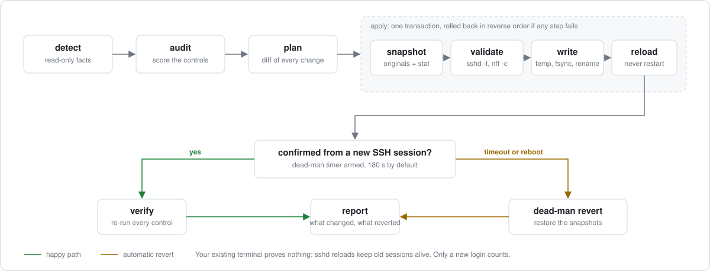

<p align="center">
  <picture>
    <source media="(prefers-color-scheme: dark)" srcset="assets/banner.svg">
    
  </picture>
</p>

<p align="center">
  <a href="https://github.com/bhimrazy/vps-ready/actions/workflows/ci.yml"></a>
  <a href="#license"></a>
  
  
</p>

**vps-ready** is a single static binary you run on a fresh Linux server. It detects what the machine is, audits what is insecure, shows you exactly what it will change, applies the changes safely, and cannot lock you out.

> **Status:** early development. The repo is private until the first read-only release (v0.1.0). Today the binary has `vpsready version`, `vpsready detect` and a first `vpsready audit` with five SSH controls; the rest arrives milestone by milestone.

## Table of contents

- [Why](#why)
- [What it does](#what-it-does)
- [Quick start](#quick-start)
- [How a run works](#how-a-run-works)
- [Safety guarantees](#safety-guarantees)
- [Supported platforms](#supported-platforms)
- [Documentation](#documentation)
- [Development](#development)
- [Contributing and security](#contributing-and-security)
- [License](#license)

## Why

You buy a VPS, get `root@ip`, and want to deploy something. Before that you should do about fifteen setup steps: a sudo user with a key, SSH hardening, a firewall that also covers Docker, automatic security updates, sane kernel settings, logging. In practice people follow an old blog post, run a random script as root, lock themselves out of SSH, or end up with a firewall that silently ignores their containers.

Auditors like Lynis tell you what is wrong but fix nothing. Ansible roles fix things but need a control node and offer no rollback. Bash "first hour" scripts have the right idea but are hard to verify and usually cover only Debian and Ubuntu. vps-ready combines the useful parts into one tool whose headline feature is that it proves you can still log in before it commits.

## What it does

| Command | What happens |
|---|---|
| `vpsready detect` | Read-only facts: distro, init system, virtualization, cloud provider, effective SSH config, listening ports, whether Docker is present |
| `vpsready audit` | Checks the host against controls with stable IDs (for example `SSH-002`), each with the reason it matters. Text or JSON; exits 0 only when every control passes |
| `vpsready plan` | A diff of every file and setting that would change, with a one-line reason for each |
| `vpsready apply` | Snapshots originals, validates, writes atomically, reloads services, and arms a dead-man timer for anything that could lock you out |
| `vpsready confirm` | Run from a **new** SSH session to prove the new configuration works. Without it, the change reverts automatically |
| `vpsready rollback` | Restores the previous state from the transaction journal |
| `vpsready export cloud-init` | Turns the profile you chose interactively into `user-data` for the next fifty servers |

Hardening is grouped into modules you can toggle: base system, admin user, SSH, firewall, brute-force protection, automatic updates, sysctl, logging, and deployment readiness (Docker done right, deploy user, reverse proxy, Tailscale, backups). Three profiles cover most people: **minimal**, **web** and **paranoid**.

## Quick start

This is the target experience for v0.1 and later. Installation is three steps on purpose: download, read, run.

```console
$ ssh root@203.0.113.10
# curl -fsSLO https://github.com/bhimrazy/vps-ready/releases/download/v0.1.0/install.sh
# less install.sh
# sh install.sh                              # verifies checksum and signature, installs to /usr/local/bin

# vpsready detect
  OS        Ubuntu 24.04 LTS (debian family), systemd, KVM, Hetzner Cloud
  SSH       OpenSSH 9.6, ssh.socket activation, port 22, passwords ENABLED (via 50-cloud-init.conf)
  Firewall  ufw installed, inactive
  You       connected from 198.51.100.7 as root

# vpsready audit
  Audit of Ubuntu 24.04.5 LTS: 23 controls

  STATUS   ID       SEVERITY  CONTROL
  FAIL     SSH-002  high      Password authentication disabled
                              passwordauthentication is yes, expected no
                              Passwords can be guessed or reused from leaks; SSH keys cannot be
                              brute-forced.
  FAIL     FW-001   high      Host firewall active
  FAIL     UPD-001  medium    Automatic security updates enabled
  PASS     MAC-001  medium    AppArmor enforcing
  ...
  14 passed, 9 failed, 0 unknown

# vpsready plan --profile web               # review the diff
# vpsready apply
  Open a NEW terminal and run:  ssh admin@203.0.113.10 sudo vpsready confirm 7F3K
  Auto-revert in 180s if not confirmed.
```

Rust users and CI can also use `cargo install vpsready --locked` (builds from source) or `cargo binstall vpsready` (fetches the release binary). Signed packages for apt, dnf and apk follow at v0.5. Details and the trust model of each channel are in [the release doc](docs/release.md).

## How a run works

<p align="center">
  <picture>
    <source media="(prefers-color-scheme: dark)" srcset="assets/how-it-works.svg">
    
  </picture>
</p>

If any step inside `apply` fails, the engine restores the snapshots in reverse order before it ever reaches the confirm step. The full design is in [the architecture doc](docs/architecture.md).

## Safety guarantees

These are enforced by the engine, not left to each module.

- **Never lock the user out.** Passwords and root login are not disabled until a keyed sudo user has logged in from a fresh session. The firewall always allows the SSH port that is actually in use.
- **Confirm from a new connection.** Your open terminal proves nothing, because sshd reloads and conntrack keep existing sessions alive. The dead-man timer reverts SSH and firewall changes unless you confirm from a new session, even if the tool or the terminal is gone, and even across a reboot.
- **Show, then do.** Nothing changes without a plan you can read. Every change carries a reversibility label: reversible, partial, or irreversible.
- **Effective state over file state.** Checks use `sshd -T`, `sysctl -n` and `ss -ltn`, not a guess at what a config file means.
- **Drop-ins, not edits.** The tool owns files like `/etc/ssh/sshd_config.d/00-vpsready.conf` and never rewrites your `sshd_config` in place. That is also what beats cloud-init re-enabling passwords.
- **Docker- and cloud-aware.** Container ports bypass ufw and firewalld by default; `ip_forward=0` kills Docker; cloud metadata must stay reachable. These are handled, not just warned about.
- **No network calls** except package installs. No telemetry, no self-update.

## Supported platforms

| Family | Distros | Firewall | Init | Status |
|---|---|---|---|---|
| Debian | Ubuntu 22.04, 24.04, 26.04; Debian 12, 13 | ufw or nftables | systemd | first (v0.1) |
| RHEL | Rocky and Alma 9, 10; Fedora | firewalld | systemd | v0.6 |
| Alpine | 3.2x | nftables | OpenRC | v0.6 |

Architectures: x86_64 and aarch64, as static musl binaries. Windows, BSD, Kubernetes nodes and fleet management are out of scope.

## Documentation

| Doc | What is inside |
|---|---|
| [Vision and scope](docs/scope.md) | The problem, the gap, principles, non-goals, and the threat model of the tool itself |
| [Security baseline](docs/security-baseline.md) | What a fresh VPS needs and why, per distro, with check and rollback commands. The spec for every module |
| [Architecture](docs/architecture.md) | Why Rust, the engine and module design, core traits, the dead-man switch, state layout, config format |
| [Supply chain and release](docs/release.md) | How users can trust a root tool: signing, provenance, reproducible builds, install script |
| [Testing strategy](docs/testing.md) | Unit tests with fakes, systemd containers, real VMs, nightly cloud runs |
| [Decisions](docs/decisions.md) | What is decided and why, and what is still open |

The roadmap lives in the [GitHub milestones](https://github.com/bhimrazy/vps-ready/milestones): M0 skeleton, M1 read-only `detect` and `audit` (v0.1.0), M2 engine and safe modules, M3 SSH, firewall and dead-man switch, M4 interactive wizard, M5 deployment readiness, M6 more distros.

## Development

Install the stable Rust toolchain with [rustup](https://rustup.rs). The repo pins it in `rust-toolchain.toml` (edition 2024, MSRV 1.98) and adds the two musl targets.

```sh
git clone https://github.com/bhimrazy/vps-ready.git
cd vps-ready
make check          # fmt, clippy with warnings denied, tests, cargo-deny
cargo run -- detect
```

| Target | What it does |
|---|---|
| `make check` | Everything CI gates on: `cargo fmt --check`, `cargo clippy -D warnings`, `cargo test`, `cargo deny check` |
| `make test` | The test suite: unit tests with the fake `Runner` and `Fs`, snapshot tests with `insta` |
| `make build-musl` | Static release builds for `x86_64-unknown-linux-musl` and `aarch64-unknown-linux-musl` |
| `make deny` | Dependency checks: advisories, licenses, banned crates and allowed sources |

The code is a Cargo workspace with one app crate (`crates/vpsready`, library plus thin binary) and, from M3, a standalone `sshd-config` parser crate. All system access goes through two traits, `Runner` and `Fs`, so every module is tested against fakes before it ever touches a real machine. The layout and the reasoning are in [the architecture doc](docs/architecture.md#repo-layout).

## Contributing and security

Contributions are welcome once the repo is public. [CONTRIBUTING.md](CONTRIBUTING.md) covers setup, the DCO sign-off, how a module is added, and what tests each kind of change needs. Lint policy: clippy defaults, plus `unwrap`, `expect` and `panic` denied outside tests.

Please report security issues, including anything that could lock a user out, through [GitHub private vulnerability reporting](https://github.com/bhimrazy/vps-ready/security/advisories/new) as described in [SECURITY.md](SECURITY.md), not in public issues.

## License

Licensed under either of [Apache License, Version 2.0](LICENSE-APACHE) or [MIT license](LICENSE-MIT) at your option.

Unless you explicitly state otherwise, any contribution intentionally submitted for inclusion in this project by you, as defined in the Apache-2.0 license, shall be dual licensed as above, without any additional terms or conditions.
