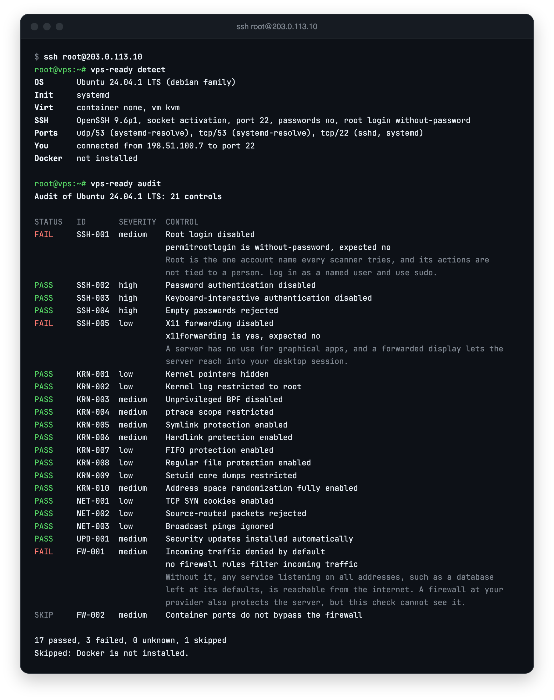
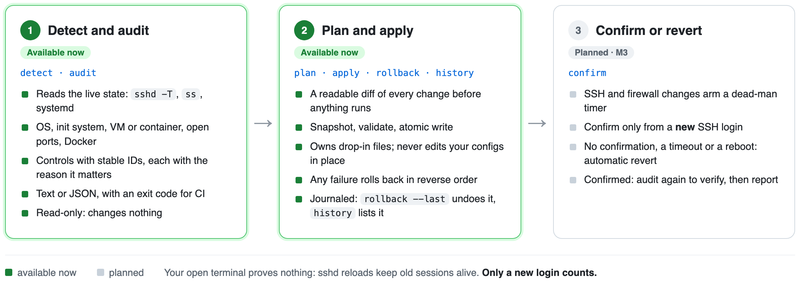

<p align="center">
  <picture>
    <source media="(prefers-color-scheme: dark)" srcset="assets/banner.svg">
    
  </picture>
</p>

<div align="center">

**One static binary to audit a fresh Linux server and harden it, with rollback, and soon without locking you out.**

<pre>
✅ Detects distro, VM, container     ✅ Audits with stable control IDs    ✅ x86_64 and arm64
✅ Reads the effective SSH config    ✅ JSON output, CI exit codes        ✅ Signed releases 
✅ Maps open ports to processes      ✅ Plan, apply and rollback          ✅ No telemetry    
</pre>

<p>
<a href="https://github.com/bhimrazy/vps-ready/actions/workflows/ci.yml"></a> <a href="https://crates.io/crates/vps-ready"></a> <a href="#license"></a> 
</p>

<p>
<a href="#quick-start">Quick start</a> &bull; <a href="#how-a-run-works">How it works</a> &bull; <a href="#safety-guarantees">Safety</a> &bull; <a href="#supported-platforms">Platforms</a> &bull; <a href="#documentation">Docs</a> &bull; <a href="#contributing-and-security">Contributing</a>
</p>

</div>

> [!NOTE]
> vps-ready is at **v0.2**. `detect` and `audit` (28 controls so far), and `plan`, `apply` and `rollback` for two modules (`kernel.sysctl` and `updates.auto`) work today. SSH and firewall hardening, with the dead-man switch, arrives in M3, and there may be breaking changes before 1.0.

## Why

You buy a VPS, get `root@ip`, and want to deploy something. Before that you should do about fifteen setup steps: a sudo user with a key, SSH hardening, a firewall that also covers Docker, automatic security updates, sane kernel settings, logging. In practice people follow an old blog post, run a random script as root, lock themselves out of SSH, or end up with a firewall that silently ignores their containers.

Auditors like Lynis tell you what is wrong but fix nothing. Ansible roles fix things but need a control node and offer no rollback. Bash "first hour" scripts have the right idea but are hard to verify and usually cover only Debian and Ubuntu. vps-ready combines the useful parts into one tool whose headline feature is that it proves you can still log in before it commits.

## Quick start

On the server, as root. Installation is three steps on purpose: download, read, run.

```console
# curl -fsSLO https://github.com/bhimrazy/vps-ready/releases/download/v0.2.0/install.sh
# less install.sh
# sh install.sh        # checks the SHA-256, verifies the signature if gh or cosign is installed
# vps-ready detect
# vps-ready audit
# vps-ready plan                  # what would change, and why; nothing is written
# vps-ready apply                 # shows the plan, asks, then applies
# vps-ready rollback --last       # restores the previous state
```

<p align="center">
  
  <br><sub>Example session on an Ubuntu 24.04 VPS.</sub>
</p>

The command is also installed as `vpsready`, without the hyphen. With Rust installed you can build from source instead: `cargo install vps-ready --locked`. Signed packages for apt, dnf and apk are planned for v0.5. The trust model of each install channel is in [the release doc](docs/release.md).

## What it does

| Command | What happens | Status |
|---|---|---|
| `vps-ready detect` | Read-only facts: distro, init system, virtualization, effective SSH config, listening ports, whether Docker is present | available |
| `vps-ready audit` | Checks the host against controls with stable IDs (for example `SSH-002`), each with the reason it matters. Text or JSON; exits 0 only when no control fails or is unknown | available |
| `vps-ready plan` | A diff of every file and setting that would change, with a one-line reason for each | available |
| `vps-ready apply` | Snapshots originals, validates, writes atomically and rolls back if anything fails. Available for `kernel.sysctl` and `updates.auto`; the dead-man timer for anything that could lock you out is M3 | available, M3 |
| `vps-ready confirm` | Run from a **new** SSH session to prove the new configuration works. Without it, the change reverts automatically | M3 |
| `vps-ready rollback` | Restores the previous state from the transaction journal (`--last` or `--txn ID`); `vps-ready history` lists transactions | available |
| `vps-ready export cloud-init` | Turns the profile you chose into `user-data` for your next servers | M5 |

Hardening will be grouped into modules you can toggle: base system, admin user, SSH, firewall, brute-force protection, automatic updates, sysctl, logging, and deployment readiness (Docker done right, deploy user, reverse proxy, Tailscale, backups). Three profiles cover most people: **minimal**, **web** and **paranoid**.

## How a run works

<p align="center">
  <picture>
    <source media="(prefers-color-scheme: dark)" srcset="assets/how-it-works.png">
    
  </picture>
</p>

If any step inside `apply` fails, the engine restores the snapshots in reverse order before it ever reaches the confirm step. The full design is in [the architecture doc](docs/architecture.md).

## Safety guarantees

The engine (M2 and M3) is built around these rules, so they hold for every module rather than being left to each one. Today `apply` changes only kernel settings and automatic updates, and none of that can lock you out; the SSH and firewall rules below are enforced from M3.

- **Never lock the user out.** Passwords and root login are not disabled until a keyed sudo user has logged in from a fresh session. The firewall always allows the SSH port that is actually in use.
- **Confirm from a new connection.** Your open terminal proves nothing, because sshd reloads and conntrack keep existing sessions alive. The dead-man timer reverts SSH and firewall changes unless you confirm from a new session, even if the tool or the terminal is gone, and even across a reboot.
- **Show, then do.** Nothing changes without a plan you can read. Every change carries a reversibility label: reversible, partial, or irreversible.
- **Effective state over file state.** Checks use `sshd -T`, `/proc/sys`, `apt-config`, `nft` and `ss`, not a guess at what a config file means.
- **Drop-ins, not edits.** The tool owns files like `/etc/ssh/sshd_config.d/00-vps-ready.conf` and never rewrites your `sshd_config` in place. That is also what beats cloud-init re-enabling passwords.
- **Docker- and cloud-aware.** Container ports bypass ufw and firewalld by default; `ip_forward=0` kills Docker; cloud metadata must stay reachable. These are handled, not just warned about.
- **No network calls** except package installs. No telemetry, no self-update.

## Supported platforms

| Family | Distros | Firewall | Init | Status |
|---|---|---|---|---|
| Debian | Ubuntu 22.04, 24.04, 26.04; Debian 12, 13 | ufw or nftables | systemd | first (v0.2) |
| RHEL | Rocky and Alma 9, 10; Fedora | firewalld | systemd | v0.6 |
| Alpine | 3.2x | nftables | OpenRC | v0.6 |

Architectures: x86_64 and aarch64, as static musl binaries. Windows, BSD, Kubernetes nodes and fleet management are out of scope.

## Documentation

| Doc | What is inside |
|---|---|
| [Vision and scope](docs/scope.md) | The problem, the gap, principles, non-goals, and the threat model of the tool itself |
| [Security baseline](docs/security-baseline.md) | What a fresh VPS needs and why, per distro, with check and rollback commands. The spec for every module |
| [Architecture](docs/architecture.md) | Why Rust, the engine and module design, core traits, the dead-man switch, state layout, config format |
| [Supply chain and release](docs/release.md) | How users can trust a root tool: signing, provenance, reproducible builds, install script |
| [Testing strategy](docs/testing.md) | Unit tests with fakes, systemd containers, real VMs, nightly cloud runs |
| [Decisions](docs/decisions.md) | What is decided and why, and what is still open |

The roadmap lives in the [GitHub milestones](https://github.com/bhimrazy/vps-ready/milestones): M0 skeleton, M1 read-only `detect` and `audit` (v0.1.0), M2 engine and safe modules (v0.2.0), M3 SSH, firewall and dead-man switch, M4 interactive wizard, M5 deployment readiness, M6 more distros.

## Development

Install [rustup](https://rustup.rs). `rust-toolchain.toml` pins the stable channel plus clippy, rustfmt and the two musl targets; `Cargo.toml` sets edition 2024 and MSRV 1.98.

```sh
git clone https://github.com/bhimrazy/vps-ready.git
cd vps-ready
make check          # fmt, clippy with warnings denied, tests, cargo-deny
cargo run -p vps-ready -- detect
```

| Target | What it does |
|---|---|
| `make check` | The local pre-push check: `cargo fmt --check`, `cargo clippy -D warnings`, `cargo test`, `cargo deny check`. CI also builds the docs, checks the MSRV and builds the musl targets |
| `make test` | The test suite: unit tests with the fake `Runner` and `Fs`, snapshot tests with `insta` |
| `make build-musl` | Static release builds for `x86_64-unknown-linux-musl` and `aarch64-unknown-linux-musl` |
| `make deny` | Dependency checks: advisories, licenses, banned crates and allowed sources |

The code is a Cargo workspace with two crates today: `crates/vps-ready` (library plus thin binary) and `crates/vpsready` (the same command under the alias name). A standalone `sshd-config` parser crate is planned for M3. All system access goes through two traits, `Runner` and `Fs`, so every module is tested against fakes before it ever touches a real machine. The layout and the reasoning are in [the architecture doc](docs/architecture.md#repo-layout).

## Contributing and security

Contributions are welcome. [CONTRIBUTING.md](CONTRIBUTING.md) covers setup, the DCO sign-off, how a module is added, and what tests each kind of change needs. Lint policy: clippy defaults, plus `unwrap`, `expect` and `panic` denied outside tests.

Please report security issues, including anything that could lock a user out, through [GitHub private vulnerability reporting](https://github.com/bhimrazy/vps-ready/security/advisories/new) as described in [SECURITY.md](SECURITY.md), not in public issues.

## License

Licensed under either of [Apache License, Version 2.0](LICENSE-APACHE) or [MIT license](LICENSE-MIT) at your option.

Unless you explicitly state otherwise, any contribution intentionally submitted for inclusion in this project by you, as defined in the Apache-2.0 license, shall be dual licensed as above, without any additional terms or conditions.
