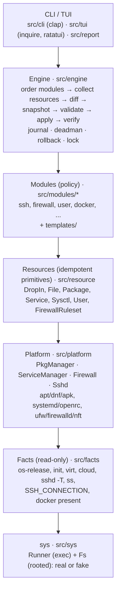
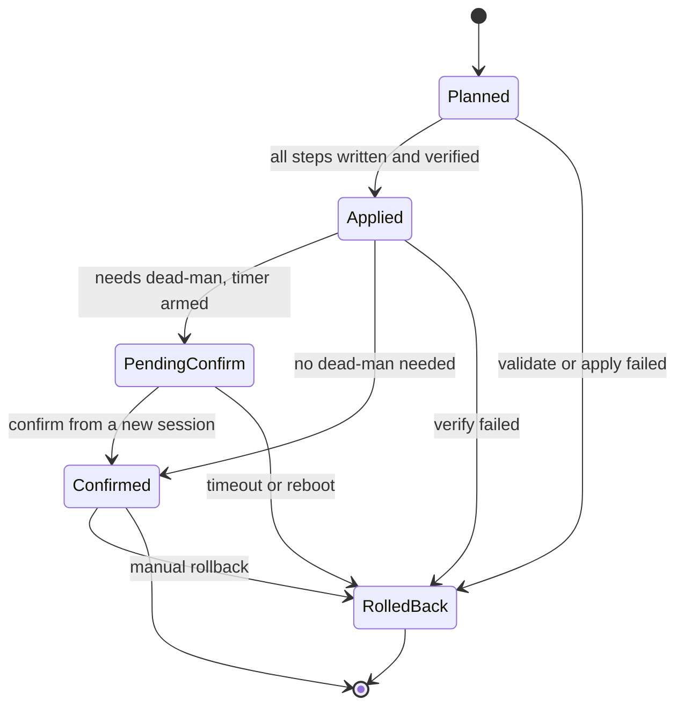
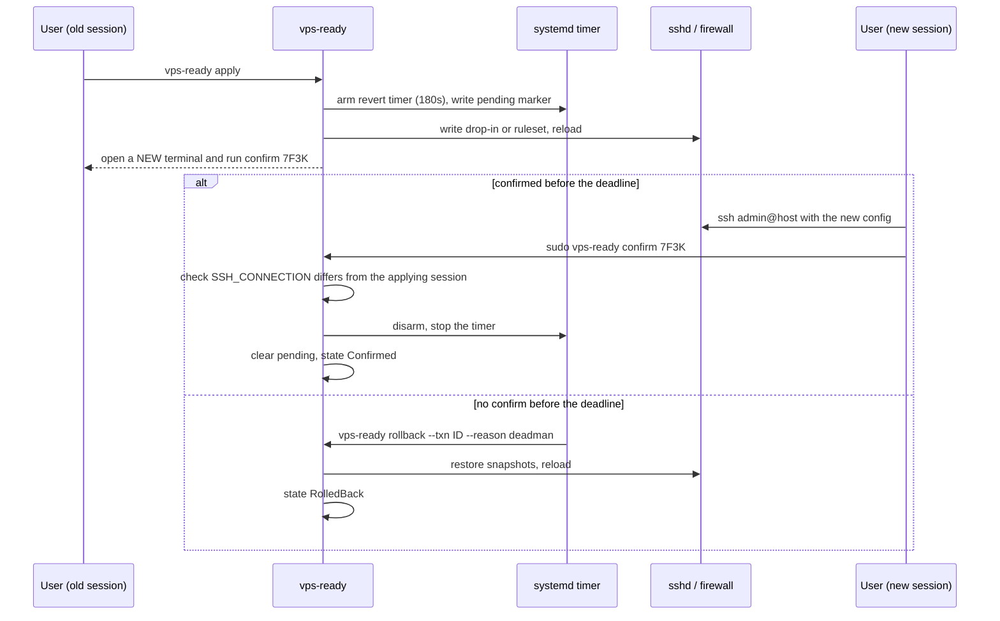

# Architecture

## Language: Rust

| | Rust | Go | Bash | Python |
|---|---|---|---|---|
| Static binary incl. Alpine/musl + arm64 | Yes: `x86_64-` / `aarch64-unknown-linux-musl` targets; both targets link with `rust-lld` and the bundled musl CRT; no cross toolchain or arm64 runner needed | Yes: `CGO_ENABLED=0 GOARCH=arm64` | n/a (but bash is missing on Alpine; busybox vs GNU differences) | No: not present on Alpine/minimal Debian |
| TUI | `inquire` (forms), `ratatui` (plan/diff view) | Charm `huh` (forms), `bubbletea` | whiptail (not everywhere) | textual (needs a runtime) |
| Who can read and contribute | Smaller among sysadmins, growing (sudo-rs, uutils coreutils) | Large infra crowd (Docker, k8s, Terraform, Tailscale, CrowdSec are Go) | Everyone, but quality varies | Ansible people |
| Plan/diff/rollback/state machine | Best fit: exhaustive `match` means a new state or label doesn't compile until every use handles it | Comfortable, but a missing `switch` case compiles silently | Collapses at this size | Comfortable |
| Release tooling | Hand-written workflow: `cargo build --locked`, cosign, attestation, `cargo-cyclonedx`; nFPM for packages | GoReleaser does build, nFPM packages, SBOM, cosign and attestations in one config | n/a | Painful |
| Size | ~3 MB (static musl, LTO, stripped) | ~10 MB | n/a | 20 to 40 MB frozen |

**Why Rust:** this tool's dangerous bugs are **logic bugs** (lockout, a non-idempotent edit, a bad rollback), not memory bugs. Rust doesn't prevent logic bugs, but its type system can make some of them unrepresentable:
- The transaction state (`Planned | Applied | PendingConfirm | Confirmed | RolledBack`) and the reversibility labels (`Reversible | Partial | Irreversible`) are enums. Every `match` on them must handle every variant, so adding a state forces every caller to decide what it means.
- Errors are values (`Result`). You can't forget to check one without the compiler or clippy telling you.
- No GC runtime, and a static musl binary is about 3 MB.
- Parsing untrusted text (`sshd -T`, `/etc/os-release`, `nft` output) has a first-class story: `serde`, `proptest`, `cargo-fuzz`.
- Ubuntu itself is moving to Rust for core tools (sudo-rs, uutils coreutils).
- And honestly: the author wants to master Rust, and this project is the vehicle.

**Trade-offs we accept, in writing:**
- **Smaller contributor pool** among sysadmins than Go. Mitigation: keep the code plain (no clever generics, no macros of our own, no async), and keep the security logic in the controls catalog (TOML) and templates that don't need Rust to review.
- **Slower compiles** than Go. Mitigation: one app crate, a short dependency list, `cargo check` in the inner loop.
- **Release tooling is less turnkey** than GoReleaser. We hand-write the release workflow (see [the release doc](release.md) and [D16](decisions.md)).

**Shell is used only for** the POSIX `install.sh` (about 150 lines) and the fixture-capture script under `test/`.

> Learning note: this project exercises the core of Rust without the hard corners: traits and trait objects (`Box<dyn Resource>`), enums with data plus `match`, error types with `thiserror`, `std::process::Command`, compile-time templates with `askama`, and testing with fakes behind a Cargo feature. No async, no lifetimes beyond the simple ones.

## Layers



Each layer only calls the one below it. The bottom layer, `sys`, is the only code that touches the real machine, which is what makes everything above it unit-testable.

### sys (`src/sys`)

Two traits, and nothing else in the codebase is allowed to run a process or touch a file directly:

Target design. Today `Fs` is read-only (`read`, `exists`, `read_dir`, `metadata`; see `crates/vps-ready/src/sys/mod.rs`); writes arrive with the engine in M2.

```rust
pub trait Runner {
    fn run(&self, cmd: &Cmd) -> Result<Output, SysError>;   // Cmd = program, args, env, timeout
}

pub trait Fs {                                              // every path is resolved under a base dir
    fn read(&self, path: &Path) -> Result<Vec<u8>, SysError>;
    fn write_atomic(&self, path: &Path, bytes: &[u8], meta: &FileMeta) -> Result<(), SysError>;
    fn stat(&self, path: &Path) -> Result<FileMeta, SysError>;
    fn exists(&self, path: &Path) -> Result<bool, SysError>;
    // ... remove, read_dir
}
```
- `RealRunner` uses `std::process::Command` and kills the child if it exceeds its timeout. `RealFs` is rooted at `/`; `rustix` for `fsync` and `flock` is planned with the engine.
- `FakeRunner` (matches argv, returns canned output) and `FakeFs` (an in-memory map of paths to contents) live behind the `testing` Cargo feature, so integration tests can use them but release binaries don't contain them.
- `Sys` bundles both, so higher layers take one `&dyn Sys` argument.

### Facts (`src/facts`)
Detection runs once, read-only, into a typed `Facts` struct (`serde` `Serialize`, so `detect --json` is free):
- OS family from `/etc/os-release` (`ID`, `ID_LIKE`, `VERSION_ID`)
- init from `/proc/1/comm`
- virtualization and container (`systemd-detect-virt`, `/.dockerenv`, DMI (planned))
- cloud provider (`cloud-id`, `/run/cloud-init/instance-data.json`, DMI vendor strings) (planned)
- effective sshd config (`sshd -T`), listening sockets, admin IP from `SSH_CONNECTION`, Docker present
- automatic updates on Debian and Ubuntu: `unattended-upgrades` installed, the effective `APT::Periodic` settings (`apt-config dump`) and the state of apt's systemd timers
- kernel settings from `/proc/sys` (not read inside a detected container, where they mostly belong to the host; a container that `systemd-detect-virt` and the Docker/Podman markers miss is read as if it were the host)

`Facts` is plain data with no methods that touch the system, so a test can build one by hand for any distro.

### Platform (`src/platform`)
Small traits chosen from facts: `PkgManager`, `ServiceManager`, `Firewall`, `Sshd` (classic vs `ssh.socket`). At startup the engine picks one implementation of each and hands modules a `Box<dyn PkgManager>` and so on.
**This is what prevents per-distro spaghetti:**
- Modules never write `if ubuntu`.
- Pure-data differences (package names, paths, service names `ssh` vs `sshd`) live in a per-family data table with version overrides.

### Resources (`src/resource`)
Idempotent primitives. Each one implements:
```rust
pub trait Resource {
    fn id(&self) -> ResourceId;
    fn current(&self, sys: &dyn Sys) -> Result<State>;
    fn diff(&self, desired: &State) -> Change;              // an empty Change = nothing to do
    fn snapshot(&self, sys: &dyn Sys) -> Result<Backup>;
    fn apply(&self, sys: &dyn Sys) -> Result<()>;
    fn restore(&self, sys: &dyn Sys, backup: &Backup) -> Result<()>;
    fn reversibility(&self) -> Reversibility;
}

pub enum Reversibility { Reversible, Partial, Irreversible }
```
`Result<T>` here is `std::result::Result<T, ResourceError>`. The plan renderer matches on `Reversibility` without a `_ =>` arm, so if a fourth label is ever added, the code that prints the plan doesn't compile until it shows that label to the user.

The kinds are `DropIn` (preferred), `File`, `LineInFile` (last resort), `Package`, `Service`, `Sysctl`, `User`, `AuthorizedKeys`, `FirewallRuleset`, and `Command` (guarded with `unless=`, discouraged).

### Modules (`src/modules/<name>/`): policy only
```rust
pub trait Module {
    fn meta(&self) -> &Meta;                                // id, title, why, risk, requires, conflicts, families, needs_deadman
    fn applicable(&self, f: &Facts) -> Applicability;       // Applicable | NotApplicable { reason }
    fn params(&self) -> &[Param];                           // drives TUI form + TOML schema + validation
    fn plan(&self, f: &Facts, p: &Params) -> Result<Vec<Box<dyn Resource>>>;
    fn validate(&self, sys: &dyn Sys) -> Result<()>;        // sshd -t, nft -c -f, visudo -c
    fn verify(&self, sys: &dyn Sys) -> Result<()>;          // post-apply: port listening, docker info
}
```
**Modules don't have apply/rollback.** The engine does both generically from resource snapshots, so every module is small, readable and reversible in the same way.

`plan` returns `Vec<Box<dyn Resource>>` because one module mixes kinds (a `DropIn`, a `Service`, a `User`). A trait object is how Rust holds different types behind one interface; it's why `Resource` has no generic methods.

### Controls catalog (declarative, auditable without reading Rust)
Controls live in `src/audit/controls/<area>.toml`, one file per area (`ssh.toml`, `kernel.toml`, `network.toml`, later `firewall.toml`, ...), using a **closed** check vocabulary. They are separate from modules because some controls have no module that fixes them. The vocabulary must not grow into a DSL:
```toml
[[control]]
id       = "SSH-002"
severity = "high"
title    = "Password authentication disabled"
why      = "Passwords can be brute-forced; keys cannot."
check    = { kind = "sshd_effective", key = "passwordauthentication", equals = "no" }
```
Check kinds: `sshd_effective`, `sysctl` and `auto_updates` are implemented; planned are `file_mode`, `file_contains`, `pkg_installed`, `service_state`, `port_listening`, `user_property`, `fw_allows`. Each is added with the first control that needs it. Later fields: `fix` (the module setting that resolves it, M2) and `refs` (CIS and Lynis IDs).

An outcome is `pass`, `fail` (with the value found), `unknown` (the fact could not be read, usually for lack of root) or `skip` (the control is not checked here, e.g. kernel settings inside a container). Unknown never counts as a pass. `audit` exits 0 when no control fails or is unknown, 1 otherwise, and 2 on error.

`sysctl` checks read `/proc/sys` directly, with no command, and only outside containers. Settings whose effect depends on several files, such as ICMP redirects (the kernel combines `all`, the interface and its forwarding state), need a check kind of their own and come later.

Facts collection runs only read-only commands. A unit test pins the exact list, and every command runs with a fixed system `PATH` and a timeout.

The vocabulary is a Rust enum deserialized with `#[serde(tag = "kind", rename_all = "snake_case")]`, so an unknown `kind` is a parse error. The files are embedded with `include_str!`, and a unit test parses every one, so a typo fails CI instead of a user's audit.

### Templates
Config files a module writes (sshd drop-ins, jail.local, nftables rulesets) are `askama` templates in `src/modules/<name>/templates/`. askama compiles templates into Rust code at build time and checks every variable against the struct that renders it, so a typo in a config template is a compile error, not a runtime surprise on a server.

### Error handling
- One `thiserror` enum per layer (`SysError`, `FactsError`, `ResourceError`, `EngineError`, `ConfigError`), each wrapping the layer below with context ("reading /etc/ssh/sshd_config: permission denied").
- `anyhow` only in the binary's edge (`main.rs` and the CLI layer), to add context, print the chain and pick the exit code. Library layers return their own `thiserror` types.
- No `unwrap()`, `expect()` or `panic!` outside tests. The clippy lints for them are denied workspace-wide, on top of clippy's defaults. A root tool that panics halfway through an edit is exactly the bug we're preventing; with `panic = "abort"` in release builds there would be no unwinding to clean up.

## Engine flow

1. **Plan:** topologically sort modules (`requires`), collect resources, diff them, and render a unified diff (via `similar`) for files and one-liners for everything else. `plan --out plan.json` → `apply plan.json` refuses if facts or file hashes have changed since.
2. **Preflight invariants** (hard-coded; overriding needs `--i-know-what-im-doing`):
   - no disabling passwords or root unless a working key exists for an allowed user;
   - the firewall always allows the *current* SSH port;
   - never block cloud metadata (169.254.169.254);
   - never set `ip_forward=0` when Docker/Tailscale is present.
3. **Apply (transaction):**
   1. `flock`
   2. snapshot (bytes + mode/owner/SELinux context)
   3. stage
   4. `validate`
   5. atomic write (temp → fsync → rename)
   6. **reload, not restart**
   7. `verify`
   8. if anything fails, roll back automatically in reverse order
4. **Idempotency:** a second `apply` produces an empty plan. Tests assert this.

The transaction's lifecycle is the `TxnState` enum, persisted in `meta.json`:

```rust
pub enum TxnState {
    Planned,
    Applied,
    PendingConfirm { code: String, deadline: SystemTime },
    Confirmed,
    RolledBack { reason: RollbackReason },   // ApplyFailed | VerifyFailed | DeadmanTimeout | Manual
}
```
The data lives inside the variant: a confirm code can only exist while the transaction is pending, and a rollback always carries its reason. Every transition passes through one function that matches on `(state, event)`; an illegal pair is an error, never a silent no-op.



## Dead-man switch (the headline feature)

For modules with `needs_deadman` (ssh, firewall, close-public-ssh):

```
arm:     systemd-run --unit=vps-ready-revert-<txn> --on-active=180s \
           /usr/local/bin/vps-ready rollback --txn <txn> --reason deadman
         + write /var/lib/vps-ready/pending  (so a reboot during the window also reverts)
apply:   reload sshd / enable firewall
prompt:  "Open a NEW terminal: ssh admin@host sudo vps-ready confirm 7F3K"
confirm: verify SSH_CONNECTION differs from the applying session (and arrived on the new port)
         → systemctl stop vps-ready-revert-<txn>.timer → clear pending → persist
timeout: revert runs even if the tool and terminal are gone
```



- **OpenRC:** a double-forked `setsid` watchdog plus a `local.d` boot hook.
- **firewalld:** runtime-only rules as a second safety net.
- **Non-interactive (cloud-init):** `--deadman=off` with the invariants still enforced, or `--deadman=selftest` (probe the new config via `ssh-keyscan localhost:<port>`).

## State layout

```
/etc/vps-ready/config.toml            last-applied profile
/var/lib/vps-ready/state.json         applied modules + managed-file hashes (drift detection)
/var/lib/vps-ready/txn/<ULID>/
    meta.json                        TxnState: planned | applied | pending-confirm | confirmed | rolled-back
    plan.json  diff.patch
    journal.jsonl                    append-only, fsync per step
    backups/<escaped-path>           original bytes + stat
/run/vps-ready/lock
/var/log/vps-ready/<txn>.log          + journald when present
```
Commands that read this: `history`, `rollback [--txn|--last]`, `drift`.

## CLI surface (v1)

Commands are `clap` derive structs in `src/cli`. Today `version`, `detect` and `audit` exist; the rest arrive with their milestones (see the GitHub milestones).

```
vps-ready                      interactive wizard (default when a TTY)
vps-ready detect               print facts (also --json)
vps-ready audit                run controls → text | json | sarif | junit; non-zero exit on fail
vps-ready plan  [--profile X] [--out plan.json]
vps-ready apply [plan.json | --profile X] [--yes] [--deadman=180s|off|selftest]
vps-ready confirm <code>
vps-ready rollback [--last | --txn ID]
vps-ready history | drift
vps-ready export cloud-init --profile X > user-data.yaml
vps-ready modules [--explain ssh]       learn-mode: what and why for each module
vps-ready version
```

## Profile format: TOML

TOML avoids YAML's foot-guns in a security config (`no` → `false`, the Norway problem, indentation surprises). Decoding is strict, there's a JSON Schema for editor completion, and a `schema = 1` version field:
- Every profile struct has `#[serde(deny_unknown_fields)]`, so `pasword_auth = false` is an error, not a silently ignored line.
- The same structs derive `schemars::JsonSchema`, so the published schema can't drift from the code.

```toml
schema  = 1
extends = "web"

[modules.ssh]
password_auth = false
permit_root   = "no"
allow_groups  = ["sshusers"]

[modules.user]
name            = "admin"
authorized_keys = ["ssh-ed25519 AAAA… me@laptop"]
sudo            = "nopasswd"     # or "password"

[modules.firewall]
backend = "auto"
allow   = ["22/tcp", "80/tcp", "443/tcp", "443/udp"]

[modules.updates]
reboot_window = "Sun 04:00"

[modules.docker]
enabled          = true
bind_ports_local = true
```

**cloud-init:** `vps-ready export cloud-init` emits `#cloud-config` that writes the profile, downloads a **pinned version, verifying its SHA256** (embedded in the user-data), and runs `apply --yes --deadman=off` from `runcmd`.

## Repo layout

A Cargo workspace. Shared metadata, dependency versions and lints are declared once at the root and inherited by each crate.

```
Cargo.toml                 workspace: [workspace.package], [workspace.dependencies], [workspace.lints]
crates/
  vps-ready/                the app (lib + thin bin)
    src/main.rs  src/lib.rs
    src/cli/               clap derive commands
    src/sys/               Runner + Fs traits; RealRunner/RealFs; FakeRunner/FakeFs (feature "testing")
    src/facts/             read-only detection into a `Facts` struct (serde)
    src/platform/          PkgManager, ServiceManager, Firewall, Sshd traits + per-family data tables (planned)
    src/resource/          Resource trait (id, current, diff, snapshot, apply, restore, reversibility) (planned)
    src/engine/            plan, diff, txn, journal, deadman, lock (planned)
    src/audit/             controls catalog (controls/*.toml), evaluation, report
    src/modules/<name>/    mod.rs + templates/ (planned)
    src/config/            TOML profiles, strict deserialize (deny_unknown_fields), JSON Schema via schemars (planned)
    src/report/            text | json | sarif | junit (planned)
    src/tui/               (planned, M4) inquire forms, ratatui plan/diff view
  vpsready/                alias crate: the same command under the name `vpsready`
  sshd-config/             (planned, M3) parser + linter for sshd_config and `sshd -T`; publishable to crates.io
profiles/                  (planned) minimal.toml  web.toml  paranoid.toml
test/                      images/Containerfile (one file, `BASE` build arg)  capture-host-fixtures.sh
                           (planned: integration/  vm/)
scripts/                   install.sh.tmpl
docs/
.github/workflows/         ci.yml codeql.yml scorecard.yml release.yml
                           (later: integration.yml vm.yml nightly-cloud.yml)
.cargo/config.toml  rust-toolchain.toml  rustfmt.toml  clippy.toml  deny.toml  Makefile
README.md SECURITY.md CONTRIBUTING.md LICENSE-APACHE LICENSE-MIT CODE_OF_CONDUCT.md .github/CODEOWNERS .github/dependabot.yml
```
- **Lib + thin bin:** `main.rs` only parses arguments and maps errors to exit codes; everything else is in the library, so tests call it directly.
- **`sshd-config` as its own crate:** the parser is useful outside this tool and has its own fuzz targets, so it gets its own crate and can be published on its own.
- Adding a module = adding one directory + registering it in one line.

**Direct dependencies (keep it to roughly these):** `clap` (derive), `serde`, `serde_json`, `toml`, `thiserror` (library errors), `anyhow` (binary and CLI layer only), `similar` (unified diffs), `ulid`, `tracing` + `tracing-subscriber`, `askama` (templates), `schemars`, `rustix` (`flock`, uid checks, `fsync`), `owo-colors`. Dev-only: `insta` (snapshots), `proptest`, `tempfile`, `assert_cmd`, `predicates`. Later: `inquire` and `ratatui` (M4), `cargo-fuzz` targets. **No async runtime:** the tool is sequential (one transaction, a handful of subprocesses), so `std::process::Command` with timeouts is enough ([D18](decisions.md)).
