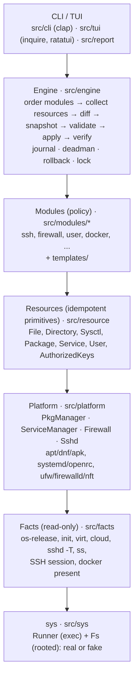
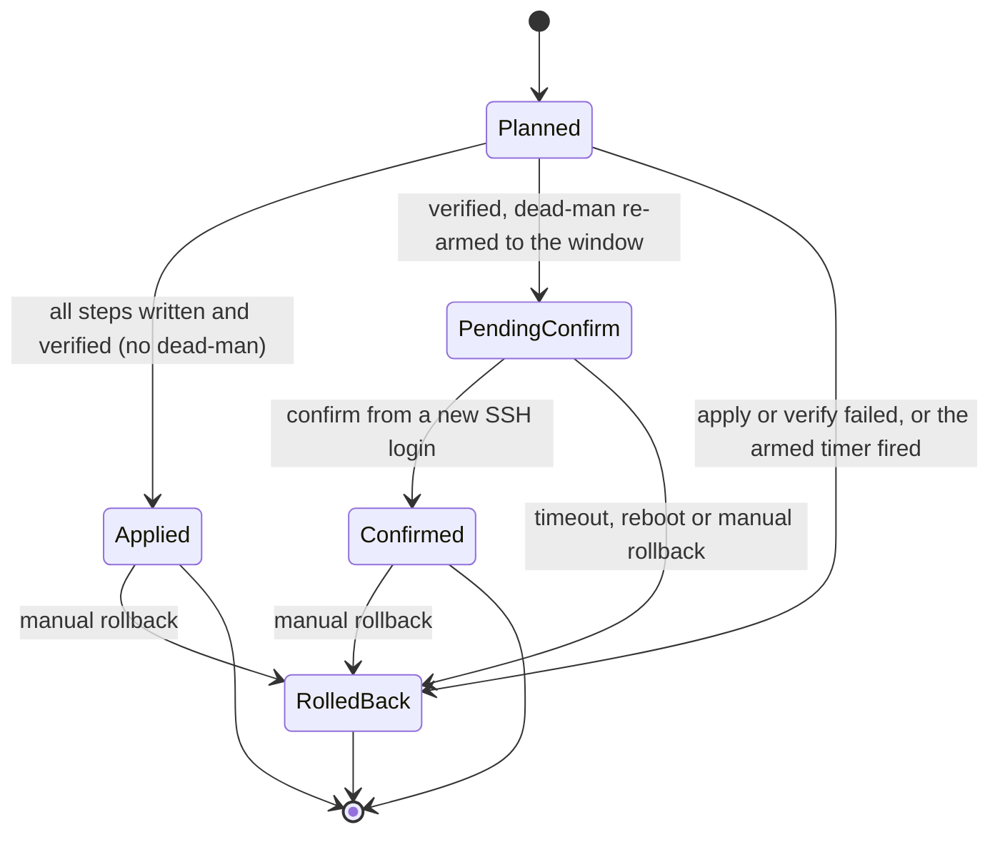
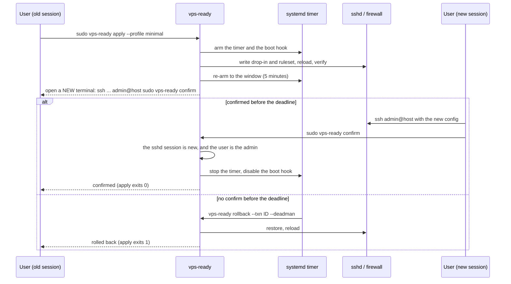

# Architecture

## Language: Rust

| | Rust | Go | Bash | Python |
|---|---|---|---|---|
| Static binary incl. Alpine/musl + arm64 | Yes: `x86_64-` / `aarch64-unknown-linux-musl` targets; both targets link with `rust-lld` and the bundled musl CRT; no cross toolchain or arm64 runner needed | Yes: `CGO_ENABLED=0 GOARCH=arm64` | n/a (but bash is missing on Alpine; busybox vs GNU differences) | No: not present on Alpine/minimal Debian |
| TUI | `inquire` (forms), `ratatui` (plan/diff view) | Charm `huh` (forms), `bubbletea` | whiptail (not everywhere) | textual (needs a runtime) |
| Who can read and contribute | Smaller among sysadmins, growing (sudo-rs, uutils coreutils) | Large infra crowd (Docker, k8s, Terraform, Tailscale, CrowdSec are Go) | Everyone, but quality varies | Ansible people |
| Plan/diff/rollback/state machine | Best fit: exhaustive `match` means a new state or label doesn't compile until every use handles it | Comfortable, but a missing `switch` case compiles silently | Collapses at this size | Comfortable |
| Release tooling | Hand-written workflow: `cargo build --locked`, cosign, attestation, `cargo-cyclonedx`; nFPM for packages | GoReleaser does build, nFPM packages, SBOM, cosign and attestations in one config | n/a | Painful |
| Size | ~3 MB (static musl, LTO, stripped) | ~10 MB | n/a | 20 to 40 MB frozen |

**Why Rust:** this tool's dangerous bugs are **logic bugs** (lockout, a non-idempotent edit, a bad rollback), not memory bugs. Rust doesn't prevent logic bugs, but its type system can make some of them unrepresentable:
- The transaction state (`Planned | Applied | PendingConfirm | Confirmed | RolledBack`) and the reversibility labels (`Reversible | Partial | Irreversible`) are enums. Every `match` on them must handle every variant, so adding a state forces every caller to decide what it means.
- Errors are values (`Result`). You can't forget to check one without the compiler or clippy telling you.
- No GC runtime, and a static musl binary is about 3 MB.
- Parsing untrusted text (`sshd -T`, `/etc/os-release`, `nft` output) has a first-class story: `serde`, `proptest`, `cargo-fuzz`.
- Ubuntu itself is moving to Rust for core tools (sudo-rs, uutils coreutils).
- And honestly: the author wants to master Rust, and this project is the vehicle.

**Trade-offs we accept, in writing:**
- **Smaller contributor pool** among sysadmins than Go. Mitigation: keep the code plain (no clever generics, no macros of our own, no async), and keep the security logic in the controls catalog (TOML) and templates that don't need Rust to review.
- **Slower compiles** than Go. Mitigation: one app crate, a short dependency list, `cargo check` in the inner loop.
- **Release tooling is less turnkey** than GoReleaser. We hand-write the release workflow (see [the release doc](release.md) and [D16](decisions.md)).

**Shell is used only for** the POSIX `install.sh` (about 150 lines) and the fixture-capture script under `test/`.

> Learning note: this project exercises the core of Rust without the hard corners: traits and trait objects (`&dyn Module`, `&dyn Fs`), enums with data plus `match`, error types with `thiserror`, `std::process::Command`, compile-time templates with `askama`, and testing with fakes behind a Cargo feature. No async, no lifetimes beyond the simple ones.

## Layers



Each layer only calls the one below it. The bottom layer, `sys`, is the only code that touches the real machine, which is what makes everything above it unit-testable.

### sys (`src/sys`)

Two traits, and nothing else in the codebase is allowed to run a process or touch a file directly:

```rust
pub trait Runner {
    fn run(&self, cmd: &Cmd) -> Result<Output, SysError>;   // Cmd = program, args, env, timeout
}

pub trait Fs {                                              // every path is resolved under a base dir
    fn read(&self, path: &Path) -> Result<Vec<u8>, SysError>;
    fn exists(&self, path: &Path) -> bool;
    fn read_dir(&self, path: &Path) -> Result<Vec<PathBuf>, SysError>;
    fn metadata(&self, path: &Path) -> Result<FileMeta, SysError>;   // lstat
    fn write_atomic(&self, path: &Path, bytes: &[u8], owner: FileOwner) -> Result<(), SysError>; // temp file, fsync, rename, fsync dir
    fn write(&self, path: &Path, bytes: &[u8]) -> Result<(), SysError>;          // in place, for /proc/sys only
    fn append_sync(&self, path: &Path, bytes: &[u8]) -> Result<(), SysError>;    // the journal
    fn remove(&self, path: &Path) -> Result<(), SysError>;
    fn create_dir_all(&self, path: &Path, mode: u32) -> Result<(), SysError>;
    fn sync_dir(&self, path: &Path) -> Result<(), SysError>;
}
```
- `RealRunner` uses `std::process::Command` and kills the child if it exceeds its timeout. `RealFs` is rooted at `/`. `fsync`, `fchown` and `flock` come from `std` (`File::sync_all`, `std::os::unix::fs::fchown`, `File::try_lock`).
- `FakeRunner` (matches argv, returns canned output) and `FakeFs` (an in-memory map of paths to contents and metadata, which can fail the n-th write, rename, remove or append) live behind the `testing` Cargo feature, so integration tests can use them but release binaries don't contain them.
- `Sys` is a small `Copy` struct holding `&dyn Fs` and `&dyn Runner`, so higher layers take one argument.

### Facts (`src/facts`)
Detection runs once, read-only, into a typed `Facts` struct (`serde` `Serialize`, so `detect --json` is free):
- OS family from `/etc/os-release` (`ID`, `ID_LIKE`, `VERSION_ID`)
- init from `/proc/1/comm`
- virtualization and container (`systemd-detect-virt`, `/.dockerenv`, DMI (planned))
- cloud provider (`cloud-id`, `/run/cloud-init/instance-data.json`, DMI vendor strings) (planned)
- effective sshd config (`sshd -T`), the `sshd_config` files and their `Include`s (the `sshd-config` crate), `ssh.socket`'s `Listen` ports, listening sockets, Docker present
- the SSH session of the user running vps-ready, from the process tree: the nearest `sshd` or `sshd-session` ancestor (`sshd: admin@pts/0`), identified by PID plus start time, with the client and server address from that process's child's `environ` and the login user from its real uid. Our own `SSH_CONNECTION` is not used: sudo's `env_reset` drops it
- the firewall: input chains of the live nftables ruleset (`nft -j list ruleset`, root only), which also holds ufw, firewalld and iptables-nft rules, with the ports each accepts from any source (`iptables-save -t filter` adds the ports of iptables `multiport` rules, which nft does not show); whether the `filter` table of iptables-legacy is loaded, for IPv4 and IPv6 each (`/proc/net/ip_tables_names`, `ip6_tables_names`), whose rules are not read; the ports Docker publishes beyond loopback and link-local, from its DNAT rules; whether the host has a global IPv6 address (`/proc/net/if_inet6`)
- whether the kernel has AppArmor enabled (`/sys/module/apparmor/parameters/enabled`)
- automatic updates on Debian and Ubuntu: `unattended-upgrades` installed, the effective `APT::Periodic` settings (`apt-config dump`) and whether systemd starts apt's daily jobs (timers and services)
- kernel settings from `/proc/sys`, including the IPv4 forwarding, redirect and reverse path settings of `all`, `default` and each interface but `lo` under `/proc/sys/net/ipv4/conf` (not read inside a detected container, where they mostly belong to the host; a container that `systemd-detect-virt` and the Docker/Podman markers miss is read as if it were the host)

`Facts` is plain data with no methods that touch the system, so a test can build one by hand for any distro.

### Platform (`src/platform`)
Small traits chosen from facts: `PkgManager`, `ServiceManager`, `Firewall`, `Sshd` (classic vs `ssh.socket`). At startup the engine picks one implementation of each and hands modules a `Box<dyn PkgManager>` and so on.
**This is what prevents per-distro spaghetti:**
- Modules never write `if ubuntu`.
- Pure-data differences (package names, paths, service names `ssh` vs `sshd`) live in a per-family data table with version overrides.

### Resources (`src/resource`)
Idempotent primitives. The set of kinds is closed, so `Resource` is an enum rather than a trait object: every `match` handles every kind, and it serializes with `serde` for the journal and `plan --json`.
```rust
pub enum Resource { File(File), Directory(Directory), Sysctl(Sysctl), Package(Package), Service(Service), User(User), AuthorizedKeys(AuthorizedKeys) }

impl Resource {
    pub fn id(&self) -> String;                                         // e.g. "file:/etc/sysctl.d/90-vps-ready.conf"
    pub fn reversibility(&self) -> Reversibility;
    pub fn diff(&self, sys: Sys) -> Result<Option<Change>>;             // None = nothing to do
    pub fn snapshot(&self, sys: Sys) -> Result<Backup>;
    pub fn apply(&self, sys: Sys) -> Result<()>;
}
pub fn restore(sys: Sys, backup: &Backup) -> Result<()>;               // needs only the journaled Backup

pub enum Reversibility { Reversible, Partial, Irreversible }
```
`Result<T>` here is `std::result::Result<T, ResourceError>`. Restore depends only on the `Backup` written to the journal, so `rollback` works in a later process without rebuilding any module's plan. The plan renderer matches on `Reversibility` without a `_ =>` arm, so if a fourth label is ever added, the code that prints the plan doesn't compile until it shows that label to the user.

A drop-in is a `File` whose whole content we own (preferred). `Directory` creates a missing directory (`/etc/vps-ready`) and removes it on rollback only if it is empty. `Service` is a systemd unit's enabled and active state; `User` is an account created with `useradd` or groups added to an existing one (`Partial`: a created user's home directory stays); `AuthorizedKeys` appends missing key lines and never removes one. The firewall is two `File`s and a `Service`, not a ruleset resource: the unit's `ExecStart`, `ExecReload` and `ExecStop` load and delete the table. `LineInFile` and `Command` are added only if a module cannot do without them.

### Modules (`src/modules/<name>/`): policy only
```rust
pub trait Module {
    fn id(&self) -> &'static str;                           // "ssh.server"
    fn title(&self) -> &'static str;
    fn why(&self) -> &'static str;
    fn needs_deadman(&self) -> bool { false }               // apply waits for a confirm
    fn force_restore(&self) -> bool { false }               // the dead-man restores its resources even if changed
    fn applicable(&self, facts: &Facts) -> Applicability;   // Applicable | NotApplicable { reason }
    fn notes(&self, facts: &Facts) -> Vec<String>;
    fn check_params(&self, params: &toml::Table) -> Result<(), ModuleError>;  // at profile parse time
    fn plan(&self, cx: &PlanCx, sys: Sys) -> Result<ModuleSteps, ModuleError>;
    fn verify(&self, cx: &PlanCx, sys: Sys) -> Result<(), String> { Ok(()) }  // sshd -T -C, nft list table
}
pub struct ModuleSteps { pub resources: Vec<Resource>, pub reloads: Vec<Reload>, pub notes: Vec<String> }
pub enum Reload { SshdReload, FirewallReload, Fail2banRestart, DaemonReload }  // journaled by name
```
**Modules don't have apply/rollback.** The engine does both generically from resource snapshots, so every module is small, readable and reversible in the same way.

`plan` returns resources plus reloads; one module can mix kinds (a `File`, a `Service`, a `User`). Each module parses its own params into a `deny_unknown_fields` struct. A file is validated before it is written (`sshd -t -f`, `nft -c -f`, `visudo -cf` on `files/<n>.after`). A `Reload` is a closed enum with a fixed check and command (`sshd -t`, then `systemctl try-reload-or-restart ssh.service`), so a rollback in a later process replays it from its journaled name, check first. There is no `requires` or topological sort yet: the registry order (`user.admin`, `ssh.server`, `firewall.inbound`, `ssh.bruteforce`, `kernel.sysctl`, `updates.auto`) is fixed, and `ssh.server`'s need for an admin is a plan-time check.

### Controls catalog (declarative, auditable without reading Rust)
Controls live in `src/audit/controls/<area>.toml`, one file per area (`ssh.toml`, `kernel.toml`, `network.toml`, later `firewall.toml`, ...), using a **closed** check vocabulary. They are separate from modules because some controls have no module that fixes them. The vocabulary must not grow into a DSL:
```toml
[[control]]
id       = "SSH-002"
severity = "high"
title    = "Password authentication disabled"
why      = "Passwords can be brute-forced; keys cannot."
check    = { kind = "sshd_effective", key = "passwordauthentication", equals = "no" }
```
Check kinds: `sshd_effective`, `ssh_rate_limited`, `sysctl`, `auto_updates`, `inbound_default_deny`, `published_ports`, `apparmor`, `reverse_path_filter`, `icmp_redirects_ignored` and `icmp_redirects_not_sent` are implemented; planned are `file_mode`, `file_contains`, `pkg_installed`, `service_state`, `port_listening`, `user_property`, `fw_allows`. Each is added with the first control that needs it. The optional `fix` names the module that resolves a failure (`fix = "kernel.sysctl"`); `audit` then prints `fix: sudo vps-ready apply --module <id>` under the failed control, and `--json` has it as `"fix": "<id>"`. A later field: `refs` (CIS and Lynis IDs).

An outcome is `pass`, `fail` (with the value found), `unknown` (the fact could not be read, usually for lack of root) or `skip` (the control is not checked here, e.g. kernel settings inside a container). Unknown never counts as a pass. `audit` exits 0 when no control fails or is unknown, 1 otherwise, and 2 on error.

`sysctl` checks read `/proc/sys` directly, with no command, and only outside containers. Settings whose effect depends on several files have a check kind of their own: for reverse path filtering and ICMP redirects the kernel combines `all` with each interface's value (and, for redirects, the interface's forwarding state), as `Documentation/networking/ip-sysctl.rst` describes, so these checks apply that rule to every interface and to `default`, whose values a new interface starts with.

Facts collection runs only read-only commands. A unit test pins the exact list, and every command runs with a fixed system `PATH` and a timeout.

The vocabulary is a Rust enum deserialized with `#[serde(tag = "kind", rename_all = "snake_case")]`, so an unknown `kind` is a parse error. The files are embedded with `include_str!`, and a unit test parses every one, so a typo fails CI instead of a user's audit.

### Templates
Config files a module writes (sshd drop-ins, jail.local, nftables rulesets) are `askama` templates in `crates/vps-ready/templates/` (`firewall.nft`, the sshd drop-in), or short `format!` strings where a template would add nothing. askama compiles templates into Rust code at build time and checks every variable against the struct that renders it, so a typo in a config template is a compile error, not a runtime surprise on a server.

### Error handling
- One `thiserror` enum per layer (`SysError`, `FactsError`, `ResourceError`, `EngineError`, `ConfigError`), each wrapping the layer below with context ("reading /etc/ssh/sshd_config: permission denied").
- `anyhow` only in the binary's edge (`main.rs` and the CLI layer), to add context, print the chain and pick the exit code. Library layers return their own `thiserror` types.
- No `unwrap()`, `expect()` or `panic!` outside tests. The clippy lints for them are denied workspace-wide, on top of clippy's defaults. A root tool that panics halfway through an edit is exactly the bug we're preventing; with `panic = "abort"` in release builds there would be no unwinding to clean up.

## Engine flow

1. **Plan:** collect resources in registry order (a topological sort on `requires` comes when an order cannot be fixed), diff them, and render a unified diff (via `similar`) for files and one-liners for everything else. Planned: `plan --out plan.json` → `apply plan.json` refuses if facts or file hashes have changed since.
2. **Preflight invariants** (hard-coded; overriding needs `--i-know-what-im-doing`):
   - no disabling passwords or root unless a working key exists for an allowed user;
   - the firewall always allows the *current* SSH port;
   - never block cloud metadata (169.254.169.254);
   - never set `ip_forward=0` when Docker/Tailscale is present.
3. **Apply (transaction):**
   1. `flock`
   2. if a module needs the dead-man, **arm it before the first change** (below)
   3. snapshot (bytes + mode/owner; later the SELinux context)
   4. stage
   5. `validate`
   6. atomic write (temp → fsync → rename)
   7. **reload, not restart**
   8. `verify`
   9. if anything fails, roll back automatically in reverse order
   10. with the dead-man: re-arm to the confirm window and wait for a confirm (`PendingConfirm`)
4. **Idempotency:** a second `apply` produces an empty plan. Tests assert this.

The transaction's lifecycle is the `TxnState` enum; the current state is the last `state` record in the transaction's journal:

```rust
#[derive(Clone, Copy)]
pub enum TxnState {
    Planned,
    Applied,
    PendingConfirm { deadline: Deadline, live_since: u64, session: Option<SessionId> },
    Confirmed,
    RolledBack { reason: RollbackReason },   // ApplyFailed | VerifyFailed | Manual | DeadmanTimeout | DeadmanReboot
}
pub struct Deadline { boottime: u64, wall: u64 }   // CLOCK_BOOTTIME seconds (with the boot ID), wall clock for display
pub struct SessionId { pid: u32, start: u64 }      // the applying sshd session: PID plus start time
```
The data lives inside the variant: a deadline only exists while the transaction is pending, and a rollback always carries its reason. There is no confirm code (see below), which keeps `TxnState` `Copy`. Every transition passes through one function that matches on `(state, event)`; an illegal pair is an error, never a silent no-op.



The journal events, one JSON object per line: `begin`, `armed` (unit, boot ID, first deadline), `backup` (with `force_restore`), `applied` (with the uid of a created account), `reloaded`, `extended` (a new unit and deadline), `confirmed` (session, user, client), `rollback`, `restored`, `skipped` (a resource the dead-man left, with the by-hand step), `reload-skipped` (a rollback reload whose check failed), `retry` (a timer that finishes an incomplete dead-man rollback) and `state`. `state pending-confirm` carries the unit, the deadline, `live_since`, the applying session, the `admins` who may confirm and the session's `ssh_port`.

## Dead-man switch (the headline feature)

For modules with `needs_deadman` (`user.admin`, `ssh.server`, `firewall.inbound`). Several of them in one apply share one transaction and one confirm. The full design and its reasons are in [the M3 plan](m3-plan.md#dead-man-switch).

```
arm:     (before the first change; a failure ends the transaction before any backup)
         check the binary: root-owned, not group- or world-writable, not under /home or /tmp
         enable the boot hook vps-ready-deadman.service
         systemd-run --unit=vps-ready-deadman-<txn>-1 --on-active=<window + every step's timeout> \
           <binary> rollback --txn <txn> --deadman
         journal "armed" {unit, boot_id, deadline}
apply:   backup, write, reload sshd / start the firewall, verify
pending: re-arm to the window (5 minutes by default) under unit -2; journal "state pending-confirm"
prompt:  "Open a NEW terminal and run:
            ssh -t -o ControlPath=none -p 22 admin@203.0.113.10 sudo vps-ready confirm"
confirm: the nearest sshd ancestor of `confirm` is a different session from apply's, started after
         the changes went live, on a port sshd listens on, logged in as the plan's admin
         → journal "confirmed" → stop the timer → disable the boot hook
timeout: the timer runs the rollback even if apply, its terminal and its SSH session are gone
reboot:  the boot hook rolls back before sshd starts (reason deadman-reboot)
```

- **Arm before the change.** A crash between a change and a later arm would leave nothing to revert it, so the timer exists before the first backup. Its first deadline covers the window plus every step's command timeout, so it cannot fire while apply is still within its limits; if it does (a hung step), the rollback waits for the lock.
- **No confirm code.** At most one transaction can be pending, so a code would pick between one choice, and a code printed in the old terminal proves nothing about the new one. The protection is the new-session check. `confirm --extend [DUR]` moves the deadline (at most 30 minutes ahead, 2 hours after the changes went live) from any session, since extending proves nothing.
- **New session, from the process tree.** sudo drops `SSH_CONNECTION`, so `confirm` walks `/proc` up to the nearest `sshd`/`sshd-session` process and compares its PID and start time with the session recorded at apply. tmux, screen, mosh, the console and `ControlMaster` connections all count as old.
- **Deadlines** are `CLOCK_BOOTTIME` seconds plus the boot ID, so an NTP step during the window changes nothing.
- **The boot hook** `/etc/systemd/system/vps-ready-deadman.service` (`DefaultDependencies=no`, `After=vps-ready-firewall.service`, `Before=ssh.service ssh.socket`, `TimeoutStartSec=120`) is written outside any transaction and enabled only while one is armed. It rolls back a transaction armed in an earlier boot, so sshd starts with the restored config; every command it runs has 20 s at most.
- **The dead-man rollback is per resource.** Resources of a module with `force_restore` (`ssh.server`, `firewall.inbound`) are restored even if edited during the window; the edit is kept as `files/<n>.during`. Any other resource that changed is skipped and journaled with its by-hand step. Restores go first and the journal is best effort, so a full disk does not stop them. If a forced restore fails, the unforced ones after it (such as the admin `user.admin` set up) wait for a rerun, so the way in stays while the lock-down does. A manual `rollback` keeps the all-or-nothing check.
- **Waiting.** `apply` counts down until the transaction leaves pending-confirm: exit 0 when confirmed, 1 when rolled back, 4 when Ctrl-C stopped the wait (the timer keeps running).



Planned:
- **OpenRC:** a double-forked `setsid` watchdog plus a `local.d` boot hook (M6; today the dead-man modules need systemd).
- **firewalld:** runtime-only rules as a second safety net (M6).
- **Non-interactive (cloud-init):** `--deadman=off` with the invariants still enforced, or `--deadman=selftest` (probe the new config via `ssh-keyscan localhost:<port>`) (M5).

## State layout

```
/var/lib/vps-ready/                   0700 root:root
    lock                             flock, held by apply and rollback
    txn/<id>/                        <id> = UTC start time, e.g. 20261023T114246Z
        journal.jsonl                append-only, fsync per line; the last "state" record is the TxnState
        files/<n>.before             original bytes of a backed-up file (mode and owner are in the journal)
        files/<n>.after              bytes vps-ready wrote
        files/<n>.during             an edit made during the confirm window, kept when the dead-man restored the file
/etc/systemd/system/vps-ready-deadman.service    the boot hook; enabled only while a transaction is armed
/etc/vps-ready/firewall.nft           firewall.inbound's table, loaded by vps-ready-firewall.service
/etc/vps-ready/config.toml            planned: last-applied profile (with `drift`)
/var/lib/vps-ready/state.json         planned: managed-file hashes for drift detection (with `drift`)
```
Commands that read this: `history`, `rollback [--txn|--last]`, `confirm`, later `drift`.

## CLI surface (v1)

Commands are `clap` derive structs in `src/cli`. Today `version`, `detect`, `audit`, `plan`, `apply`, `confirm`, `rollback` and `history` exist; the rest arrive with their milestones (see the GitHub milestones).

```
vps-ready                      interactive wizard (default when a TTY)
vps-ready detect               print facts (also --json)
vps-ready audit [--all]         run controls → text | json | sarif | junit; non-zero exit on fail
                               text lists failed and unknown controls; --all adds passed and skipped
vps-ready plan  [--profile X] [--module M] [--out plan.json]
vps-ready apply [plan.json | --profile X] [--module M] [--yes] [--deadman 5m|off|selftest]
vps-ready confirm [--txn ID] [--extend [DUR]]
vps-ready rollback [--last | --txn ID]
vps-ready history | drift
vps-ready export cloud-init --profile X > user-data.yaml
vps-ready modules [ID]                  list modules; with an ID, what and why, params, controls fixed
vps-ready version
```

## Profile format: TOML

TOML avoids YAML's foot-guns in a security config (`no` → `false`, the Norway problem, indentation surprises). Decoding is strict, with a `schema = 1` version field (planned: a JSON Schema for editor completion, with the wizard in M4):
- Every module's params struct has `#[serde(deny_unknown_fields)]`, and every section is checked when the profile is parsed, so a typo is an error that names the module, not a silently ignored line.
- Planned: the same structs derive `schemars::JsonSchema`, so the published schema can't drift from the code.

The built-in profiles are `minimal` (`user.admin`, `ssh.server`, `firewall.inbound` allowing `22/tcp`, `kernel.sysctl`, `updates.auto`) and `web` (the same, plus `80/tcp`, `443/tcp`, `443/udp` and `ssh.bruteforce`). A file can extend one of them (one level), override a module's fields, or drop a module with `enabled = false`; tables merge one level deep and lists replace:

```toml
schema  = 1
extends = "web"

[modules."user.admin"]
name            = "deploy"
authorized_keys = ["ssh-ed25519 AAAAC3Nza... me@laptop"]
sudo            = "nopasswd"     # or "password"

[modules."firewall.inbound"]
allow = ["22/tcp", "443/tcp"]

[modules."ssh.bruteforce"]
enabled = false
```

Without `--profile` or `--module`, `plan` and `apply` select only `kernel.sysctl` and `updates.auto`, so an upgrade never makes a plain `apply` start changing SSH or the firewall.

**cloud-init:** `vps-ready export cloud-init` emits `#cloud-config` that writes the profile, downloads a **pinned version, verifying its SHA256** (embedded in the user-data), and runs `apply --yes --deadman=off` from `runcmd`.

## Repo layout

A Cargo workspace. Shared metadata, dependency versions and lints are declared once at the root and inherited by each crate.

```
Cargo.toml                 workspace: [workspace.package], [workspace.dependencies], [workspace.lints]
crates/
  vps-ready/                the app (lib + thin bin)
    src/main.rs  src/lib.rs
    src/cli/               clap derive commands
    src/sys/               Runner + Fs traits; RealRunner/RealFs; FakeRunner/FakeFs (feature "testing")
    src/facts/             read-only detection into a `Facts` struct (serde)
    src/platform/          PkgManager, ServiceManager, Firewall, Sshd traits + per-family data tables (planned)
    src/resource/          Resource enum (id, diff, snapshot, apply, reversibility) + restore
    src/engine/            plan, txn, journal, reloads, deadman, confirm, lock
    src/audit/             controls catalog (controls/*.toml), evaluation, report
    src/modules/           <name>.rs + <name>/ (tests, snapshots)
    templates/             askama templates of the files modules write
    src/config/            TOML profiles (profiles/minimal.toml, web.toml), strict deserialize; JSON Schema via schemars (planned)
    src/report/            text | json | sarif | junit (planned)
    src/tui/               (planned, M4) inquire forms, ratatui plan/diff view
  vpsready/                alias crate: the same command under the name `vpsready`
  sshd-config/             reader for sshd_config and its Includes, parser for `sshd -T`; published to crates.io
profiles/                  README; the built-in profiles live in crates/vps-ready/src/config/profiles/ (paranoid planned)
test/                      images/Containerfile (one file, `BASE` build arg)  capture-host-fixtures.sh
                           container-*.sh (layer 2)  vm-cycle.sh (layer 3)
scripts/                   install.sh.tmpl
docs/
.github/workflows/         ci.yml codeql.yml scorecard.yml release.yml vm.yml
                           (later: nightly-cloud.yml)
.cargo/config.toml  rust-toolchain.toml  rustfmt.toml  clippy.toml  deny.toml  Makefile
README.md SECURITY.md CONTRIBUTING.md LICENSE-APACHE LICENSE-MIT CODE_OF_CONDUCT.md .github/CODEOWNERS .github/dependabot.yml
```
- **Lib + thin bin:** `main.rs` only parses arguments and maps errors to exit codes; everything else is in the library, so tests call it directly.
- **`sshd-config` as its own crate:** the parser is useful outside this tool, so it is its own crate, published on its own from v0.3.0. It has property tests; fuzz targets are planned.
- Adding a module = adding one directory + registering it in one line.

**Direct dependencies (keep it to roughly these):** `clap` (derive), `serde`, `serde_json`, `toml`, `thiserror` (library errors), `anyhow` (binary and CLI layer only), `similar` (unified diffs), `tracing` + `tracing-subscriber`, `askama` (templates), `owo-colors`, `rustix` (`*at` file calls that never follow a symlinked parent), `signal-hook` (Ctrl-C while apply waits for a confirm); later `schemars`. `std` covers `flock`, `fsync` and `fchown`. Dev-only: `insta` (snapshots), `proptest`, `tempfile`, `assert_cmd`, `predicates`. Later: `inquire` and `ratatui` (M4), `cargo-fuzz` targets. **No async runtime:** the tool is sequential (one transaction, a handful of subprocesses), so `std::process::Command` with timeouts is enough ([D18](decisions.md)).
