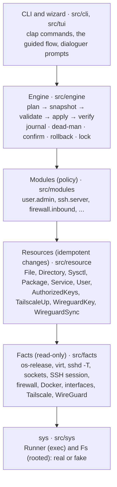
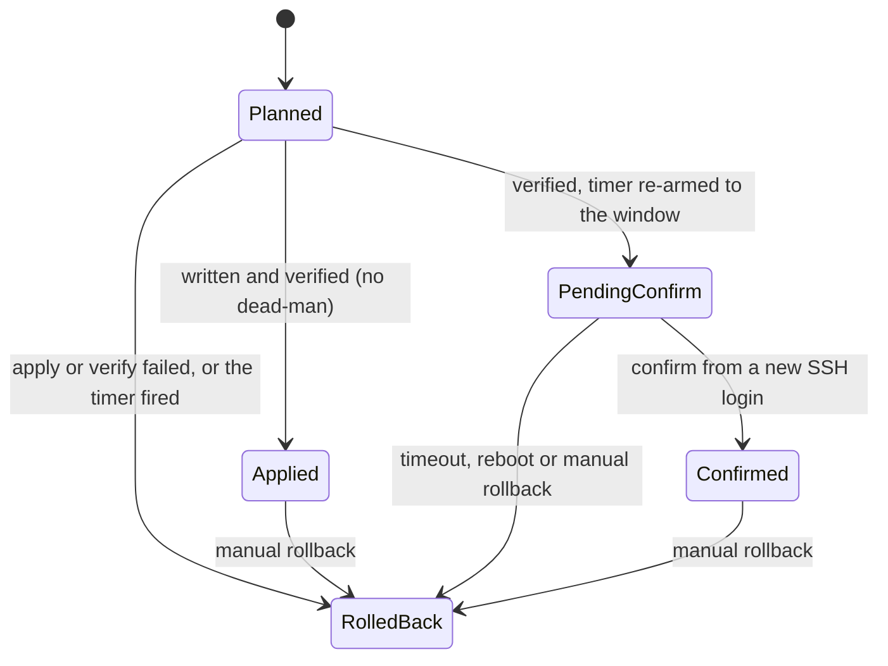
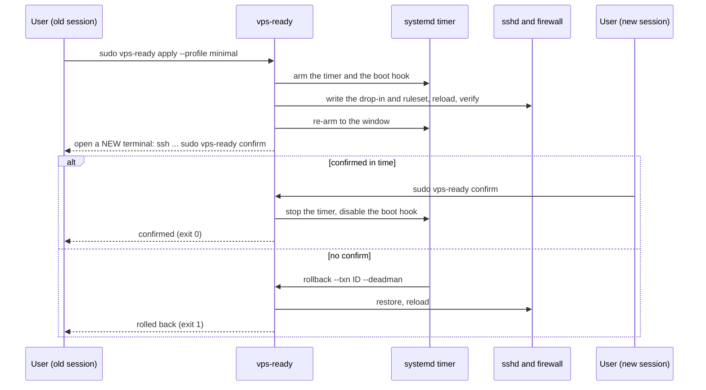

# Design

This is the maintainers' design document for vps-ready: what it is for, how it works, the security model behind it, the decisions that shaped it and how it is tested. It describes the code as it is. Plans for coming releases live in [the M7 plan](m7-plan.md), and the release process in [the release doc](release.md).

For what each command, module and control does, use the user docs instead: `vps-ready --help`, `vps-ready modules [ID]`, and the site's [commands](https://vps-ready.bhimraj.com.np/docs/reference/commands/) and [security controls](https://vps-ready.bhimraj.com.np/docs/reference/security-controls/) reference.

- [Scope and principles](#scope-and-principles)
- [How it works](#how-it-works)
  - [Architecture](#architecture)
  - [Engine flow](#engine-flow)
  - [Dead-man switch](#dead-man-switch)
  - [State layout](#state-layout)
  - [Files vps-ready writes](#files-vps-ready-writes)
  - [Profile format](#profile-format)
  - [Repo layout](#repo-layout)
- [Security model](#security-model)
  - [Safe order of operations](#safe-order-of-operations)
  - [Threat model of the tool](#threat-model-of-the-tool)
  - [Top 10 gotchas](#top-10-gotchas)
- [Decisions](#decisions)
- [Testing](#testing)

## Scope and principles

Someone buys a small VPS, gets `root@ip` with a password or one key, and wants to deploy an app. Before that they should do about fifteen setup steps. In practice they follow an old guide that conflicts with today's distro defaults (cloud-init drop-ins, `ssh.socket`, Debian 13 ignoring `/etc/sysctl.conf`), run a script as root without reading it, lock themselves out of SSH, or end up with a firewall that silently does not apply to Docker containers.

Each fix exists somewhere already. vps-ready puts them in one tool for one server, run interactively or from a file, and proves the admin can still log in before it keeps a change. It does a few things safely rather than many:

- **Provisioning first.** The first minutes after `ssh root@new-vps`, plus deployment readiness: an admin user, SSH, a firewall, updates, Docker with safe defaults, a reverse proxy, a deploy user, private access.
- **Lockout-safe.** Root and password logins stay on until a keyed sudo user exists, the firewall always keeps the current SSH port, and changes that could lock someone out revert unless a new SSH login confirms them.
- **Plan, apply, verify, roll back**, with a readable diff and a reversibility label on every change: reversible or partial.
- **Audit and fix share one rule set.** Controls have stable IDs, and a control a module fixes names that module.
- **Export.** A profile used once interactively becomes cloud-init `user-data` for the next server.
- **Trust.** Signed releases with provenance, a `.deb`, and no `curl | sh` required.

### Principles

1. **Guard against lockouts.** Every risky step is gated, validated and reversible on a timer.
2. **Show, then do.** Nothing changes without a visible plan, unless `--yes` says so.
3. **Explain why.** Every control and module carries a one-line reason.
4. **Drop-ins over edits.** vps-ready owns its own files and never rewrites a distro's main config file in place.
5. **Effective state over file state.** Checks use `sshd -T`, `/proc/sys`, `apt-config`, `nft` and `ss`, not a guess at what a file means.
6. **Small and boring beats broad.** A few well-tested modules beat many untested ones.
7. **No telemetry.** The network is used only for package installs, the services a module sets up (Tailscale, the tunnel), and `deploy.proxy`'s plan-time DNS lookup.

### Non-goals

- Formal compliance (CIS Level 2, STIG). vps-ready makes no compliance claim.
- Fleet management or a central server; export to cloud-init instead.
- A web UI.
- Managing applications after deploy.
- Kubernetes nodes, Windows and BSD.
- Backups (see the M7 plan's pairing note).

## How it works

### Architecture



Each layer calls only the ones below it. `sys` is the only code that touches the machine, which is what makes everything above it unit-testable. There is no platform adapter layer yet: Debian and Ubuntu with systemd are the only family, so modules call apt and systemd through resources. Adapters (`PkgManager`, `ServiceManager`, `Firewall`) come with a second family.

#### sys

Nothing else in the codebase runs a process or touches a file directly:

```rust
pub trait Runner {
    fn run(&self, cmd: &Cmd) -> Result<Output, SysError>;  // program, args, env, timeout, stdin file, stdout to a new file
}

pub trait Fs {                                             // abridged; every path resolved under a base directory
    fn read(&self, path: &Path) -> Result<Vec<u8>, SysError>;
    fn exists(&self, path: &Path) -> bool;
    fn read_dir(&self, path: &Path) -> Result<Vec<PathBuf>, SysError>;
    fn metadata(&self, path: &Path) -> Result<FileMeta, SysError>;   // lstat
    fn write_atomic(&self, path: &Path, bytes: &[u8], owner: FileOwner) -> Result<(), SysError>;
    fn write(&self, path: &Path, bytes: &[u8]) -> Result<(), SysError>;        // in place, /proc/sys only
    fn append_sync(&self, path: &Path, bytes: &[u8]) -> Result<(), SysError>;  // the journal
    fn remove(&self, path: &Path) -> Result<(), SysError>;
    fn create_dir_all(&self, path: &Path, mode: u32) -> Result<(), SysError>;
    fn sync_dir(&self, path: &Path) -> Result<(), SysError>;
}
```

- `RealRunner` kills a child that exceeds its timeout, and runs every command with a fixed system `PATH`. `RealFs` is rooted at `/` and uses `*at` calls (`rustix`) so it never follows a symlinked parent.
- `write_atomic` refuses a symlink target, writes `.<name>.vps-ready-tmp` with `O_EXCL`, sets mode and owner, fsyncs, renames over the target and fsyncs the directory.
- `FakeRunner` (argv in, canned output out) and `FakeFs` (an in-memory tree that can fail the n-th write, rename, remove or append) exist only behind the `testing` feature, so release binaries do not contain them.
- `Sys` is a `Copy` struct of `&dyn Fs` and `&dyn Runner`.

#### Facts

Detection runs once, read-only, into a plain `Facts` struct (`serde::Serialize`, so `detect --json` is free). A unit test pins the exact list of commands it may run. The less obvious facts:

- **The SSH session** comes from the process tree, not `SSH_CONNECTION`, which sudo's `env_reset` drops. The nearest `sshd` or `sshd-session` ancestor is the session, identified by PID plus start time; its child's `environ` gives the client and server address, and the child's real uid gives the login user.
- **The firewall** is the input chains of the live nftables ruleset, which also holds ufw, firewalld and iptables-nft rules, plus `iptables-save` for `multiport` rules and a flag when the iptables-legacy `filter` table is loaded (its rules are not read).
- **Docker** facts read `docker info` and friends only while `docker.service` is active, so detection never starts it through its socket.
- **Kernel settings** are read from `/proc/sys`, per interface where the kernel combines values, and not inside a detected container, where they belong to the host.

#### Resources

A resource is one idempotent change, such as a file, a package or a service state. The set of kinds is closed, so `Resource` is an enum: every `match` handles every kind, and it serializes for the journal and `plan --json`.

```rust
pub enum Resource { File, Directory, Sysctl, Package, Service, User, AuthorizedKeys, TailscaleUp, WireguardKey, WireguardSync }

impl Resource {
    pub fn id(&self) -> String;                              // "file:/etc/sysctl.d/90-vps-ready.conf"
    pub fn reversibility(&self) -> Reversibility;            // Reversible | Partial
    pub fn diff(&self, sys: Sys) -> Result<Option<Change>>;  // None: nothing to do
    pub fn snapshot(&self, sys: Sys, txn_dir: &Path, n: u32) -> Result<Backup>;  // writes files/<n>.before and .after
    pub fn apply(&self, sys: Sys) -> Result<Applied>;
}
pub fn restore(sys: Sys, txn_dir: &Path, backup: &Backup) -> Result<()>;  // the journaled Backup and files/
```

- **Restore needs only the journaled `Backup` and the transaction's `files/`**, so `rollback` works in a later process, perhaps a newer binary, without rebuilding any module's plan.
- A `File` is a whole file vps-ready owns, optionally validated on its `.after` copy before it is written (`sshd -t -f`, `nft -c -f`, `visudo -cf`, `apt-config`), and may carry a one-line `describe` instead of a diff (vendor keys show their fingerprint). It refuses a symlink or a missing parent.
- `Package` installs what is missing with one `apt-get update` and one `apt-get install --no-install-recommends` per module (`Partial`: rollback leaves packages installed).
- `Directory` removes on rollback only what it created and only when empty. `User` is `Partial` (a created user's home stays). `AuthorizedKeys` appends missing lines and never removes one.
- `WireguardKey` runs `wg genkey` with stdout opened by vps-ready as a new 0600 file, so the key never passes through vps-ready; its backup holds only a public key, and rollback keeps the key. `WireguardSync` diffs the running `wg0` against `wg0.conf` and applies only `wg set` commands, never `wg syncconf`; it is a resource rather than a reload because the engine skips the reloads of a module with no resource change, so a drifted `wg0` behind unchanged files would never be put back. vps-ready never runs `wg showconf`, and a `wg0.conf` holding a `PrivateKey` is not managed, so it is never copied into `files/`.
- The firewall is two `File`s and a `Service`, not a ruleset resource: the unit's `ExecStart`, `ExecReload` and `ExecStop` load and delete vps-ready's table.

#### Modules

Modules are policy only. They plan resources and reloads; they have no apply or rollback of their own, so every module is small and reverts the same way.

```rust
pub trait Module {
    fn id(&self) -> &'static str;                            // "ssh.server"
    fn title(&self) -> &'static str;
    fn why(&self) -> &'static str;
    fn needs_deadman(&self) -> bool { false }                // the static answer, for `modules` and the wizard
    fn force_restore(&self) -> bool { false }                // the dead-man restores its resources even if edited
    fn params_doc(&self) -> &'static [ParamDoc] { &[] }
    fn applicable(&self, facts: &Facts) -> Applicability;    // Applicable | NotApplicable { reason }
    fn notes(&self, facts: &Facts) -> Vec<String>;
    fn check_params(&self, params: &toml::Table) -> Result<(), ModuleError>;
    fn plan(&self, cx: &PlanCx, sys: Sys) -> Result<ModuleSteps, ModuleError>;
    fn verify(&self, cx: &PlanCx, sys: Sys) -> Result<(), String> { Ok(()) }
    fn verify_timeout(&self) -> Duration;                    // counted into the timer's first deadline
}
pub struct ModuleSteps { pub resources: Vec<Resource>, pub reloads: Vec<Reload>, pub notes: Vec<String>, pub deadman: bool }
pub enum Reload { SshdReload, FirewallReload, Fail2banRestart, DaemonReload, DockerRestart, CaddyReload, CloudflaredRestart }
```

- Each module parses its params into a `deny_unknown_fields` struct, so a typo names the module.
- A `Reload` is a closed enum with a fixed check and command (`sshd -t`, then `systemctl try-reload-or-restart ssh.service`), journaled by name. A rollback replays it after the restore, check first; a failed check skips it (`reload-skipped`), so a listener keeps its running config rather than dying on a broken one.
- `ModuleSteps.deadman` lets a module ask for the timer on this host only: a VPN module does when the loaded ruleset limits SSH to its interface.
- The registry order is fixed: `user.admin`, `ssh.server`, `net.tailscale`, `net.wireguard`, `net.tunnel`, `deploy.docker`, `firewall.inbound`, `ssh.bruteforce`, `kernel.sysctl`, `updates.auto`, `deploy.proxy`, `deploy.user`. A module sees what earlier modules planned (`PlanCx.planned`): `firewall.inbound` opens Docker's bridges and the WireGuard port for modules planned before it, and the WireGuard port of the `ssh_via` interface, and `deploy.proxy` reads the ruleset and whether a tunnel is planned. `ssh.server`'s need for an admin is a plan-time check, so there is no `requires` or topological sort.

#### Controls catalog

Controls live in `src/audit/controls/<area>.toml`, separate from modules because some controls have no module that fixes them. Each uses a closed check vocabulary, so the catalog is reviewable without reading Rust and never grows into a language:

```toml
[[control]]
id       = "SSH-002"
severity = "high"
title    = "Password authentication disabled"
why      = "Passwords can be guessed or reused from leaks; SSH keys cannot be brute-forced."
check    = { kind = "sshd_effective", key = "passwordauthentication", equals = "no" }
fix      = "ssh.server"
```

- The kinds are a Rust enum deserialized with `#[serde(tag = "kind")]`, so an unknown kind is a parse error. The files are embedded with `include_str!`, and a unit test parses every one. A kind is added with the first control that needs it.
- `fix` names the module that resolves a failure; `audit` prints `fix: sudo vps-ready apply --module <id>` under it. A finding may carry a `note` with what the check saw (`FW-003` lists every exposed port).
- An outcome is `pass`, `fail`, `unknown` (the fact could not be read) or `skip` (not checked here). Unknown never counts as a pass.
- Settings the kernel combines from several values (reverse path filtering, ICMP redirects) have check kinds of their own that apply the kernel's rule to every interface and to `default`.

#### Templates and errors

- Whole config files (the sshd drop-in, the nftables ruleset, the cloudflared unit and its restart script) are `askama` templates in `crates/vps-ready/templates/`, checked at compile time; short files are `format!` strings. `insta` snapshots pin every rendered file.
- One `thiserror` enum per layer, each wrapping the one below with context. `anyhow` only at the binary's edge.
- No `unwrap`, `expect` or `panic!` outside tests; the clippy lints for them are denied workspace-wide. A panic halfway through an edit would leave a half-written config on a server.

#### The wizard

With no subcommand on a terminal, `vps-ready` runs the wizard (`src/cli/wizard.rs`); otherwise it prints help and exits 2. The wizard is a front end, not a new path: it builds a `Profile` with a `ProfileBuilder` (which can also write it as TOML) and hands it to `apply_profile`, the code `apply --profile` uses. So the plan, the prompt and the timer are the ones `apply` has, and anything the wizard does, `apply --profile <file>` repeats. All prompts go through a `Prompt` trait in `src/tui`, with a `dialoguer` implementation and a scripted one for tests.

### Engine flow

1. **Plan.** Collect facts, plan every selected module in registry order, render a unified diff for files and one line for everything else.
2. **Preflight invariants**, enforced by the modules at plan time:
   - root and password logins are not turned off unless a non-root user with keys and sudo exists (the plan's admin);
   - the firewall always accepts every current SSH port: the applying session's, every port sshd listens on, and `ssh.socket`'s. `ct state established` alone is not enough, since a flow that predates conntrack is dropped without a rule for its port;
   - outbound traffic is never filtered, so cloud metadata stays reachable;
   - `ip_forward`, `accept_ra` and `rp_filter` are never written.
3. **Apply**, as one transaction:
   1. take the lock (`flock`, never waiting) and refuse if any transaction is unfinished or pending;
   2. print the plan, ask, then re-run every `diff()` and abort if the changes differ from what was shown;
   3. journal `begin`; if any module needs the dead-man, arm it now, before the first change;
   4. for each module in order: each of its resources (snapshot to `.before` and `.after`, fsynced; validate; journal `backup`; apply; journal `applied`), then that module's reloads, check first;
   5. verify: every `diff()` is empty again, plus each module's `verify` (`sshd -T -C` for the admin, the table read back);
   6. on any failure, restore in reverse journal order;
   7. with the dead-man: re-arm to the confirm window and wait (`PendingConfirm`); otherwise journal `state applied`;
   8. re-run the audit for the controls the plan fixes, for information.
4. **Idempotency.** A second apply plans nothing.

The `backup` record is fsynced before its resource is touched, so after a crash every resource that may have changed has a backup on disk.

The transaction's state is the last `state` record in its journal:

```rust
pub enum TxnState {
    Planned,
    Applied,
    PendingConfirm { deadline: Deadline, live_since: u64, session: Option<SessionId> },
    Confirmed,
    RolledBack { reason: RollbackReason },  // ApplyFailed | VerifyFailed | Manual | DeadmanTimeout | DeadmanReboot
}
```



Every transition passes through one function that matches on `(state, event)`; an illegal pair is an error, never a silent no-op.

**The journal** is one JSON object per line, fsynced per line: `begin` (version and `format`), `armed`, `backup` (with `force_restore`), `applied`, `reloaded`, `extended`, `confirmed`, `rollback`, `restored`, `skipped`, `reload-skipped`, `retry` and `state`. A torn final line is a crash and is ignored; any other bad line is an error. Unknown fields are ignored. `begin` carries `format: 1` from 0.7.0, and a binary refuses a higher format by name ("use that version or newer") before parsing anything else, so a newer record kind never fails as a parse error.

**Rollback** (`rollback --last` or `--txn`) journals `rollback` first, so a crash mid-way leaves an unfinished transaction that a rerun resumes. A manual rollback is all or nothing: every resource must still be at its applied or original state, or the engine restores nothing and prints each by-hand step. That also stops an older transaction from undoing a newer one on the same file. Exit codes: 0 rolled back, 2 refused or error, 3 incomplete.

### Dead-man switch

The modules that can lock someone out (`user.admin`, `ssh.server`, `firewall.inbound`), and a VPN module whose interface SSH depends on, run behind a timer. Several in one apply share one transaction and one confirm: a single new login proves the user, the sshd config and the firewall together.

```
arm:      check the binary and every parent: root-owned, not group- or world-writable,
          not under /home, /tmp, /var/tmp or /dev/shm
          copy it to /var/lib/vps-ready/bin/vps-ready (root, 0755)
          enable the boot hook vps-ready-deadman.service, which runs the copy
          systemd-run --unit=vps-ready-deadman-<txn>-1 --on-active=<window + every step's timeout> \
            /var/lib/vps-ready/bin/vps-ready rollback --txn <txn> --deadman
          journal "armed" {unit, boot_id, deadline}
apply:    back up, write, reload, verify
pending:  re-arm to the window (5 minutes by default) as unit -2; journal "state pending-confirm"
prompt:   Open a NEW terminal and run:
            ssh -t -o ControlPath=none -p 22 admin@203.0.113.10 sudo vps-ready confirm
confirm:  a different sshd session from apply's, started after the changes went live,
          on a port sshd listens on, as the plan's admin, from a client that is not this host,
          and under ssh_via, to an address of that interface
          → journal "confirmed" → stop the timer → disable the boot hook
timeout:  the timer rolls back, even if apply, its terminal and its SSH session are gone
reboot:   the boot hook rolls back before sshd starts (reason deadman-reboot)
```

- **Arm before the change.** The timer exists before the first backup, so a crash at any point after a change has something to revert it. The first deadline covers the window plus every step's command timeout, so it cannot fire while apply is within its limits; if it does (a hung step), the rollback waits for the lock.
- **A transient systemd timer**, handed to PID 1, outside the user's session, so it fires when the SSH connection and the apply process are gone, including with logind's `KillUserProcesses=yes`.
- **Deadlines** are `CLOCK_BOOTTIME` seconds plus the boot ID, so an NTP step in the window changes nothing.
- **The boot hook**, `/etc/systemd/system/vps-ready-deadman.service`, is written outside any transaction and enabled only while one is armed. It has `DefaultDependencies=no`, `After=local-fs.target vps-ready-firewall.service`, `Before=ssh.service ssh.socket docker.service caddy.service vps-ready-cloudflared.service shutdown.target` and `TimeoutStartSec=120`, and bounds every command to 20 seconds. It rolls back any transaction armed in an earlier boot, so sshd starts with the restored config; a reboot counts as not confirmed, since the user may have rebooted because they were locked out. If it times out, sshd starts anyway and the transaction stays pending for a manual rollback.
- **The window** is 5 minutes, counted from when the changes are live (`apply --deadman 1m` to `30m`). `confirm --extend [DUR]` works from any session, since extending proves nothing, up to 30 minutes ahead and 2 hours after the changes went live.
- **Waiting.** `apply` counts down and exits 0 when confirmed, 1 when rolled back, and 4 when Ctrl-C stopped the wait (the timer keeps running). `history` shows `pending-confirm (reverts in 3m12s)`.
- **The dead-man rollback is per resource.** Resources of `ssh.server` and `firewall.inbound` (`force_restore`), and of a VPN module that asked for the timer through `ModuleSteps.deadman`, are restored even if someone edited them during the window; the engine keeps the edit as `files/<n>.during`. It skips any other resource that changed and journals the by-hand step. Restores come first and the journal is best effort, so a full disk does not stop them. If a forced restore fails, the unforced ones after it (the admin `user.admin` made) wait for a rerun, so the admin account stays as long as the SSH and firewall changes do.
- **Guarded manual rollbacks.** Under `ssh_via`, a manual rollback that would limit SSH to an interface again runs only from a login through it, since no timer covers it. One that would stop a `tailscaled` or `wg-quick@wg0` its transaction started, or run `tailscale down`, is refused if SSH afterwards depends on that interface or the session comes through it, and so is one that would take the session's own WireGuard peer off `wg0`. A pending or unfinished transaction is exempt from the `ssh_via` guard, since its rollback only does what the dead-man would. Removing an admin account `user.admin` created is refused while a later transaction is applied, confirmed or pending (it may rely on that account), and for the account running the rollback.



**Without the timer.** `apply --deadman=off` applies the dead-man modules without arming anything, for a first boot from `export cloud-init`, where nobody can confirm. The plan-time invariants still hold. It needs positive evidence that nobody is logged in: no per-session sshd process in `/proc` and no `loginctl` session of class `user`. vps-ready refuses it with an explicit `ssh_via` and in the `private` profile's step 2, and `history` shows the transaction as applied without the timer. A crash mid-apply with the timer off leaves an unfinished transaction, with nothing to roll it back until `rollback --last`.

The timer needs systemd. Planned: an OpenRC watchdog and firewalld runtime-only rules, with those distro families.

### State layout

```
/var/lib/vps-ready/                0700 root:root; refused if a symlink, not root's, or group/other-writable
    lock                           flock, held by apply and rollback
    bin/vps-ready                  the copy of the binary the timer and boot hook run
    txn/<id>/                      <id> = UTC start time, e.g. 20261023T114246Z
        journal.jsonl              append-only, fsync per line
        files/<n>.before           original bytes of a backed-up file (mode and owner are in the journal)
        files/<n>.after            bytes vps-ready wrote, and what validate checked
        files/<n>.during           an edit made in the window, kept when the dead-man restored the file
/etc/systemd/system/vps-ready-deadman.service   the boot hook
/etc/vps-ready/                    firewall.nft, profile.toml (from export), cloudflared.yml,
                                   cloudflared-restart.sh, cloudflared-token (written by the wizard)
```

`history`, `rollback` and `confirm` read this. Planned for v0.8.0: `/etc/vps-ready/config.toml` with `drift`.

### Files vps-ready writes

vps-ready never edits a distro's main config file. It adds its own file to the program's drop-in directory, so the change stays separate and rollback only removes it. The number in the name sets its place in the program's read order, and what that order means depends on the program:

| Program | File | Merge rule | So the name |
|---|---|---|---|
| sshd | `/etc/ssh/sshd_config.d/00-vps-ready.conf` | the first value read for a keyword wins; the `Include` at the top of `sshd_config` reads `*.conf` in name order ([sshd_config(5)](https://man.openbsd.org/sshd_config)) | `00-`, before cloud-init's `50-cloud-init.conf`. The plan refuses when that `Include` is missing, sits in a `Match` block, or comes after a line that sets the same keyword |
| sysctl | `/etc/sysctl.d/90-vps-ready.conf` | the last file read wins, sorted by name across directories ([sysctl.d(5)](https://www.freedesktop.org/software/systemd/man/latest/sysctl.d.html)) | `90-`, the top of the range systemd suggests for `/etc`. A `99-*` file, including Debian 12's and Ubuntu's `99-sysctl.conf`, can still override it |
| sudo | `/etc/sudoers.d/90-vps-ready-admin`, `90-vps-ready-deploy` | the last matching rule wins; `@includedir` skips names with a `.` or ending in `~` ([sudoers(5)](https://www.sudo.ws/docs/man/sudoers.man/)) | `90-`, after the distro's rules, with no dot. Validated with `visudo -cf`, mode 0440 |
| apt | `/etc/apt/apt.conf.d/52vps-ready`, `52vps-ready-tailscale`, `52vps-ready-cloudflared` | read in name order, later wins; names are letters, digits, `_`, `-` and `.` ([apt.conf(5)](https://manpages.debian.org/apt.conf.5)) | apt's own style; `52` after `20auto-upgrades` and `50unattended-upgrades` |
| fail2ban | `/etc/fail2ban/jail.d/90-vps-ready.local` | `jail.conf`, `jail.d/*.conf`, `jail.local`, `jail.d/*.local`, later wins ([jail.conf(5)](https://manpages.debian.org/jail.conf.5)) | `.local`, read last; it sets only `[sshd]`, never `[DEFAULT]`, so other jails keep the admin's settings |
| systemd | `/etc/systemd/system/vps-ready-*.service`, `wg-quick@wg0.service.d/10-vps-ready.conf` | `/etc/systemd/system` is for units the admin adds ([systemd.unit(5)](https://www.freedesktop.org/software/systemd/man/latest/systemd.unit.html)) | prefixed `vps-ready-`, so they never clash with a package's unit |

Vendor repositories are deb822 files in `/etc/apt/sources.list.d/<name>.sources` with their key in `/etc/apt/keyrings/<name>.asc`. A few whole files belong to a program but have no drop-in directory: `/etc/docker/daemon.json` (merged key by key, other keys kept), `/etc/caddy/Caddyfile` and `/etc/wireguard/wg0.conf` (each managed only while it carries vps-ready's header, so a hand-written one is left alone). Every file vps-ready writes whose format allows comments starts with a `# Written by vps-ready` comment that names the module and says how to undo it.

A new module follows the same rules: use the drop-in directory when there is one, pick the number from that program's merge rule (low when the first value wins, high when the last does), follow the directory's naming style, and check that the program actually reads the name.

### Profile format

Profiles are TOML, which avoids YAML's surprises in a security config (`no` becoming `false`, indentation). Decoding is strict, with `schema = 1`. The parser checks every module section, even for a module that does not apply on this host.

The built-in profiles are embedded from `crates/vps-ready/src/config/profiles/`:

| Profile | Modules |
|---|---|
| `minimal` | `user.admin`, `ssh.server`, `firewall.inbound` (`22/tcp`), `kernel.sysctl`, `updates.auto` |
| `web` | the same with `22/tcp`, `80/tcp`, `443/tcp` and `443/udp`, plus `ssh.bruteforce` and `deploy.docker` |
| `private` | `minimal` plus `ssh.bruteforce`, with `allow = []` and `ssh_via = "vpn"`; used through `extends` with one VPN module |

A file can extend one built-in profile (one level), override a module's fields, or drop a module with `enabled = false`. Tables merge one level deep and lists replace:

```toml
schema  = 1
extends = "web"

[modules."user.admin"]
name            = "deploy"
authorized_keys = ["ssh-ed25519 AAAAC3Nza... me@laptop"]

[modules."ssh.bruteforce"]
enabled = false
```

Without `--profile` or `--module`, `plan` and `apply` select only `kernel.sysctl` and `updates.auto`, so an upgrade never makes a plain `apply` start changing SSH or the firewall.

**cloud-init export.** `vps-ready export cloud-init --profile <file> --checksums checksums.txt` prints `#cloud-config` with the profile as `/etc/vps-ready/profile.toml` (0600) and one `runcmd` script: download this version's tarball for `uname -m` with `curl` or `wget`, check its SHA-256 from the user's verified `checksums.txt`, install to `/usr/local/bin`, and run `apply --profile /etc/vps-ready/profile.toml --yes --deadman=off`. `--base-url` changes where the tarball comes from, not what runs. A failure leaves the image's defaults, and `cloud-init status` shows `error`.

### Repo layout

```
Cargo.toml                 workspace: shared package metadata, dependency versions and lints
crates/
  vps-ready/               the app (library plus a thin main.rs)
    src/cli/               clap commands; wizard.rs, module_docs.rs (`modules`), export
    src/tui/               the Prompt trait and its dialoguer implementation
    src/engine/            plan, run, journal, reloads, deadman, confirm, lock, txn IDs
    src/modules/           <name>.rs plus <name>/ (tests, snapshots)
    src/resource/          the Resource enum, restore, apt_source
    src/facts/             read-only detection
    src/audit/             the controls catalog (controls/*.toml) and evaluation
    src/config/            profiles (profiles/*.toml) and strict parsing
    src/sys/               Runner and Fs, real and fake
    templates/             askama templates
    keys/                  embedded vendor apt keys
    testdata/              host fixtures captured from real images
    tests/                 CLI tests and journal fixtures per 0.x release
  vpsready/                alias crate: the same command as `vpsready`
  sshd-config/             reader for sshd_config and its Includes, parser for `sshd -T`; on crates.io
fuzz/                      cargo-fuzz targets
test/                      the container image, container-*.sh, vm-cycle.sh, fixture capture
packaging/                 nFPM config for the .deb
scripts/install.sh.tmpl    the per-release install script
site/                      the user docs and landing page
```

- **Library plus thin binary:** `main.rs` parses arguments and maps errors to exit codes; tests call the library directly.
- **Adding a module** is one file plus a directory, and one line in the registry.
- **Direct dependencies** stay short: `clap`, `serde`, `serde_json`, `toml`, `thiserror`, `anyhow` (binary edge only), `similar`, `tracing`, `tracing-subscriber`, `askama`, `owo-colors`, `rustix`, `signal-hook`, `dialoguer` (in `src/tui` only), `zeroize` (for pasted secrets) and the workspace's own `sshd-config`. Dev only: `insta`, `proptest`, `tempfile`, `assert_cmd`, `predicates`. `std` covers `flock`, `fsync` and `fchown`.

## Security model

### Safe order of operations

The engine and the built-in profiles enforce this order:

1. **Look first.** `detect` and `audit` are read-only. Take a provider snapshot before the first apply.
2. **Admin, SSH and firewall, in one transaction with one confirm.** `user.admin` gives a non-root user keys and sudo; `ssh.server` turns off root and password logins; `firewall.inbound` drops unsolicited inbound traffic while keeping every current SSH port. The engine arms the timer before the first change, and the confirm is `sudo vps-ready confirm` from a new login as the admin, which proves the key, the sshd config, the firewall and sudo in one step. `--module user.admin` first, then the rest, shows which step fails.
3. **Changes that cannot lock anyone out:** `kernel.sysctl`, `updates.auto`, `ssh.bruteforce`.
4. **Deployment modules:** `deploy.docker`, `deploy.proxy`, `deploy.user`. None touches sshd, the firewall's SSH rule or the admin's login.
5. **Private access in two applies.** Set up a VPN (`net.tailscale` or `net.wireguard`) with public SSH still open, log in through it, and from that session apply `ssh_via` to close public SSH; the confirm must come from a new login through the VPN. A website then goes through `net.tunnel` so 80 and 443 can close too.
6. **Re-audit.** Every apply re-runs the controls it fixed.

> **Why a new connection?** An sshd reload keeps existing sessions alive, and so does the firewall's `established` rule. Your open terminal proves nothing about the next login.

### Threat model of the tool

vps-ready runs as root on a fresh server, so the question is also how it could hurt its users:

| Threat | Mitigation |
|---|---|
| A malicious or compromised release | Keyless cosign signature over `checksums.txt`, SLSA build provenance, immutable releases, `v*` tags only an admin can create (see [the release doc](release.md)) |
| A compromised install script | Generated per release with the hashes embedded; the docs say download, read, run |
| A compromised dependency | A short dependency list, `cargo deny` (RustSec advisories, licenses, sources) in CI, Dependabot with a cooldown, vendor apt keys embedded and checked weekly |
| The tool locks the user out | The plan-time invariants, the dead-man switch, and VM tests of every revert path |
| The tool weakens security by mistake | The post-apply audit, and snapshot tests of every rendered config |
| Secrets in logs, plans or backups | Modules take secrets as root-only files the engine never opens (Tailscale's `file:`, the tunnel's `LoadCredential=`, `wg genkey` to a file); none reaches argv, the plan, the journal or `files/<n>`. The wizard holds a pasted auth key or tunnel token, zeroized, only long enough to write that file after the yes, with signals held back, and never writes it to `vps-ready.toml` |
| Privilege escalation through state | Root-owned 0700 state, refused when its permissions are wrong; atomic writes with `O_EXCL`; the timer runs a root-owned copy of the binary, never a path a user can replace |
| A root timer running a user-writable binary | The binary-path check before arming, and the private copy under `/var/lib/vps-ready/bin` |

### Top 10 gotchas

Each one has a rule in the code and a test (see [Testing](#testing)):

1. **cloud-init re-enables passwords** with `50-cloud-init.conf`. The `00-` drop-in is read first, and verify reads `sshd -T -C`, not the file.
2. **A `Match` block overrides the drop-in** for the connections it matches, and plain `sshd -T` does not show it. Verify runs `sshd -T -C` for the admin, and the audit reads `Match` blocks that set a checked keyword and fails the control, naming the file and line.
3. **`ssh.socket` owns the port** on Ubuntu 22.10 and later. The port stays 22, and `ssh.socket`'s `Listen` ports count as current SSH ports for the firewall and the confirm.
4. **The firewall loads before SSH is allowed, or forgets IPv6.** The ruleset always accepts every current SSH port, the `inet` table covers both families, and ICMPv6 is never blocked. A provider firewall is out of reach; `FW-001` sees only the host's.
5. **An admin with no password whose sudo asks for one, with root logins off, leaves no way to root.** A created admin gets `NOPASSWD`, `user.admin` refuses `sudo = "password"` unless the account already has a password hash, and the confirm itself runs `sudo`.
6. **A locked password blocks key logins with `UsePAM no`.** The module reads `usepam` and creates the user with password `*` then.
7. **Root's keys on cloud images carry `command="echo Please login as ..."`.** Copied as is, they would make the new admin unusable, so `user.admin` skips key lines with options and says so in a note.
8. **Docker bypasses the host firewall,** and a firewall reset wipes Docker's chains. vps-ready owns one table and never flushes others, accepts input from Docker's bridges, and `deploy.docker` binds published ports to `127.0.0.1` by default. `FW-002` reports the ports still published publicly; no module fixes it.
9. **Kernel settings that break networking:** `ip_forward=0` stops Docker and VPNs, `accept_ra=0` drops SLAAC IPv6, `rp_filter=1` breaks VPN routing, and Debian 13 ignores `/etc/sysctl.conf`. vps-ready never writes those keys and uses `sysctl.d`.
10. **Updates that interrupt services.** `updates.auto` does not set `Automatic-Reboot`, and Docker's and Caddy's origins stay out of unattended upgrades, so they do not restart containers or the proxy on their own. Tailscale's and cloudflared's origins are added, since SSH or the website depends on them, and a path unit restarts the connector onto the new binary.

## Decisions

Each decision with its reason. Where the code later departed from a plan, this records what was built.

### Foundations

- **Rust.** The dangerous bugs in this tool are logic bugs (a lockout, a non-idempotent edit, a bad rollback). Exhaustive `match` on the transaction state and the reversibility labels means a new variant does not compile until every use handles it, errors are values, and a static musl binary is about 3 MB. The author also chose it to master the language. Accepted costs: a smaller contributor pool among sysadmins, slower compiles and a hand-written release pipeline. Go was the alternative, with the same architecture.
- **Modules declare resources; one engine applies and rolls back.** The risk lives in one heavily tested place instead of in every module.
- **Restore needs only the journal.** A rollback may run in a later process or a newer binary, so restore is a function of the journaled `Backup`, never of what a module would plan today. This is also why `Resource` and `Reload` are closed enums journaled by name.
- **Controls in TOML with a closed check vocabulary**, reviewable without Rust; a full DSL was rejected as scope creep.
- **TOML profiles**, not YAML.
- **Drop-in files only**, never edits of main config files.
- **The SSH port stays 22.** Changing it touches the firewall, the provider firewall, `ssh.socket` and fail2ban, and a mistake in any of them locks the admin out, all for less log noise. A private network with `ssh_via` takes the port off the internet instead.
- **Read-only `audit` shipped first** (v0.1.0): useful at once, with no risk.
- **Debian and Ubuntu first.** Most VPS images are one of the two. Other families come on demand (see the M7 plan).
- **MIT OR Apache-2.0, DCO, no CLA**: Apache's patent grant, MIT's GPLv2 compatibility, and embeddable by hosting providers.
- **Signed releases with provenance and no self-update.** People run a root tool only if they can verify it, and a binary that replaces itself adds a way in for a program that usually runs once per server.
- **A hand-written release pipeline.** With two musl targets, a generated workflow of several hundred lines is not justified, and every release step should be short enough to audit.
- **`askama` templates**, so a typo in a config template is a build error, not a surprise on a server.
- **No async runtime.** The tool is sequential: one transaction and a handful of subprocesses.
- **One name, `vps-ready`,** for the repo, crate and command, with `vpsready` as an alias crate and command so a look-alike cannot take it.
- **Native checks only.** vps-ready neither bundles nor calls an external auditor; the checks it needs are in its own catalog.

### Engine (v0.2.0)

- **`kernel.sysctl` and `updates.auto` first**, since neither can lock anyone out, yet together they exercise files, `/proc/sys`, a package and validation.
- **A key goes into the sysctl drop-in only if its running value fails the control** (or the drop-in already lists it), so a distro's stricter value (Ubuntu's `perf_event_paranoid=4`) is never lowered at the next boot.
- **`kptr_restrict=1`, not `2`**: `2` hides `/proc/kallsyms` from root too and breaks `perf` and `bpftrace`.
- **No values the kernel will not take back at runtime** (`unprivileged_bpf_disabled=1`, `ptrace_scope=3`), since rollback could not restore them before a reboot.
- **Rollback leaves an installed package installed**, labeled partial: removing it could take dependencies with it.
- **A manual rollback is all or nothing**, and refuses when anything changed since apply. It is the only way to never overwrite a later change by hand or by a newer transaction.
- **`apply` refuses while any transaction is unfinished**, and never rolls back on its own; `rollback --last` resumes the unfinished one.
- **Exit code 3** when a rollback did not complete, naming the transaction directory and what is left by hand.
- **The lock never waits**: a second `apply` fails at once rather than queueing behind a confirm window.
- **Transaction IDs are UTC timestamps**, sortable by name, with no extra crate.
- **`updates.auto` runs `apt-get update` before installing** (fresh images have stale lists) and does not set `Automatic-Reboot`, which would override the admin's choice.

### Lockout-safe changes (v0.3.0)

- **One transaction and one confirm** for `user.admin`, `ssh.server` and `firewall.inbound`, rather than three challenges: one new login proves all three, and step by step stays possible with `--module`.
- **Arm before the change.** An earlier design armed after apply; a crash between a change and the arm would have left nothing to revert it.
- **No confirm code.** At most one transaction is pending, so a code would pick between one choice, and a code printed in the old terminal proves nothing about the new one. The new-session check is the protection.
- **Why each confirm rule.** The session must start after the changes went live, because a terminal opened before apply survives the reload too; on a port the host's sshd listens on, because a rescue sshd proves nothing about the applied config; and from a client that is not this host, because loopback traffic passes any firewall. Confirming from the same or any session, as other confirm-or-revert tools do, catches a change that kills the connection but not the common lockout where open connections survive and new ones fail.
- **The process tree, not `SSH_CONNECTION`.** sudo's `env_reset` drops it on every supported distro, and asking users for `--preserve-env` is fragile. `loginctl` and utmp were rejected: another source to parse for the same answer, and utmp has no entry for `ssh host cmd`.
- **No special sudo rule for confirm.** A `NOPASSWD` rule scoped to `vps-ready confirm` would let the confirm pass while the admin's real sudo is broken, which is the lockout it exists to catch.
- **A 5-minute default window**: 3 minutes was short for opening a terminal, finding the key and typing a command. The extend caps keep a forgotten window from staying open for hours.
- **A transient systemd timer**, not a detached process, which a session teardown, the OOM killer or a reboot can take with it.
- **The boot hook has only the ordering edges it needs.** Every extra edge is a chance for a cycle, and systemd breaks a cycle by dropping a unit, which may be `ssh.socket`. An earlier draft's `After=network-pre.target` formed one on hosts with firewalld.
- **The dead-man force-restores the resources that can lock someone out** (`ssh.server`, `firewall.inbound`, and a VPN module that asked for the timer through `ModuleSteps.deadman`) even if edited. An all-or-nothing rule there would mean "the admin edited the drop-in in the window, nothing reverted, locked out". `user.admin` is not forced: leaving an added key is not a lockout.
- **The binary check before arming** (the binary and every parent directory root-owned and not group- or world-writable, nowhere under `/home`, `/tmp`, `/var/tmp` or `/dev/shm`): a root timer that runs a file a user can replace is a root shell for that user.
- **`ssh.server` never writes `Port`, `ListenAddress`, `AllowGroups`, `AuthenticationMethods` or crypto lists.** Each can cut the admin off or break clients for little gain, and a unit test enforces the list. It manages only the keywords of `SSH-001` to `SSH-007`.
- **`nftables` in vps-ready's own table and unit, not ufw.** One backend for Debian and Ubuntu, one file that `nft -c -f` validates and loads atomically, and a rollback that deletes only `inet vps_ready`, leaving Docker's, fail2ban's and the admin's rules. Not `nftables.service`, whose config starts with `flush ruleset`. Not applicable while ufw or firewalld is active. The cost is that `ufw status` does not show these rules.
- **Accept input from Docker's bridges** when Docker is present, so containers that reach host services keep working; the plan says a compromised container can then reach them too.
- **Drop IPv4 TCP with IP options** in a `prerouting` chain at `raw` priority, so packets exploiting CVE-2026-98432 are dropped before conntrack, including on Docker's published ports. The kernel update is the fix.
- **`sudo = "nopasswd"` by default** for a created admin, as cloud images do for their default user; an existing user with sudo keeps it untouched.
- **fail2ban for brute force, in `web` and `private` only.** Local, packaged and without network calls; once SSH is key-only brute force is mostly noise, and OpenSSH 9.8 slows repeated failures itself. Its drop-in sets only `[sshd]`.
- **VM tests on plain QEMU with KVM**, not a VM manager: a locked-out VM gets SSH back when the timer fires, so no side channel is needed.

### The wizard (v0.4.0)

- **The bare command is the wizard on a terminal**, help otherwise, with no `wizard` subcommand, so scripts see no change.
- **Root, the binary check and a pending transaction are checked before the first question**, so nobody answers everything and then fails at apply.
- **Public listeners are offered unchecked** under "Unchecked ports will be blocked": checked would keep a database reachable. Docker's published ports are left out, since this firewall does not filter them.
- **Customized answers are saved to `vps-ready.toml`**, holding only what differs from the built-in profile, so the "next time" command repeats the run.
- **Paste a key when none is found**, rather than stopping with instructions.
- **`dialoguer`, not a heavier prompt library**, for its small, already-reviewed dependency tree in a static binary that runs as root.
- **`modules <ID>`** instead of `modules --explain <ID>`. It does not list the files a module touches: they depend on the host, so that needs a plan.

### Deployment (v0.5.0)

- **Split the milestone into v0.5.0 and v0.6.0.** The deploy modules touch neither sshd nor the SSH rule, so they cannot lock an admin out; private access changes the SSH path or turns the timer off, so it was reviewed as one change to the safety model.
- **Vendor apt keys are embedded in the binary** with their fingerprints, never downloaded at apply time: a key fetched on the server trusts whatever the URL serves that day. A weekly job compares them with the vendors' published keys.
- **Docker publishes on loopback by default** (`ip` and `default-network-opts`), instead of filtering the `forward` hook, which would have to track Docker's own chain changes. `FW-002` keeps reporting ports published on a public address.
- **`web` gains `deploy.docker` only;** Caddy joins when the user gives a domain, since a hardening run should not start a web server nobody configured.
- **A hand-written Caddyfile, `wg0.conf` or `daemon.json` that is not JSON is left alone**: replacing someone's working config is not a hardening step.
- **`deploy.user`'s key runs one command, which may re-run itself as root through sudo with no arguments; the command must be a root-owned file.** The module refuses an existing account vps-ready did not create, so nobody gets restricted keys or the docker group by surprise.
- **`.deb` only**, since vps-ready runs only on Debian and Ubuntu.
- **The timer and boot hook run a private copy of the binary.** They used to name the installed path, so moving between `install.sh` and the `.deb`, or upgrading, while a transaction was pending broke the unattended rollback. The copy is made at arm time, so the rollback is also the version that applied.

### Private access (v0.6.0)

- **Public SSH closes only from a session that already comes through the private interface.** After `ssh_via`, a broken VPN means no SSH at all, so closing public SSH is always a second apply, after the private path has carried a real login. The confirm must then be a new login through it. One apply that brings up the VPN and closes 22, relying on the timer alone, was rejected.
- **`ssh_via` is refused at plan time** when the interface is down or has no address, when the VPN's unit is not enabled at boot, or when the interface can never be private (`lo`, container and VM bridges, the interface of the default route), since each closes SSH with no working path behind it.
- **Staged `ssh_via = "vpn"` in the `private` profile.** It resolves to the profile's one VPN module, keeps SSH public with a note in step 1, and closes it in step 2, so both steps are the same command with the same file, and the export can carry it (at first boot it stays in step 1).
- **Under `ssh_via`, any change to that VPN arms the timer** with the stricter confirm, and a change that would cut the applying session (its own peer, `tailscaled`) is refused: once SSH depends on the interface, changing it is the close step again.
- **When the loaded ruleset already has the same `ssh_via`, the session refusals become notes,** so an apply from the console still works while the VPN is down.
- **Firewall only; sshd keeps listening on all addresses.** `ListenAddress` on a tunnel address fails at boot when sshd starts before the VPN.
- **`iifname`, not `iif`,** so the rule loads before the interface exists and survives its recreation.
- **SSH ports in `allow` are left out with a note** when `ssh_via` is set, so profiles that extend `minimal` or `web` keep working.
- **A console password is a note, not a refusal.** Rescue mode exists at every major provider, and setting a password is the admin's choice.
- **Refuse `ssh_via = "tailscale0"` while the node key expires,** since SSH would otherwise close on a date months away.
- **Tailscale joins with `--auth-key=file:<path>`** from a root-only file, so the key never reaches the engine's memory, argv or the journal; `--accept-dns=false`, since a server does not need the tailnet's DNS and rollback could not cleanly restore the resolver; **never `--ssh`**, which would replace sshd's authentication and leave `confirm` nothing to check; rollback runs `tailscale down`, never `logout`, which would spend a one-off key.
- **Tailscale and cloudflared update through unattended-upgrades**, since a host that depends on them for access must get their fixes.
- **WireGuard's subnet is a `/24` in `10.0.0.0/8` derived from the machine ID**, collision-checked, with `address` to override: stable without stored state and different per server, so one laptop can reach several. Each peer sets an explicit `host`, so removing a peer never moves another.
- **`wg set`, never `wg syncconf`,** plus an empty `ExecReload=`: a VM check showed `syncconf` with a key-less config clears the key that `PostUp` loaded, which would cut every tunnel.
- **Rollback keeps the generated WireGuard key**, so client configs made during a timed-out first setup keep working.
- **Peers bring their public keys**; no server-generated client keys and no QR code, so a private key never leaves its device.
- **`export cloud-init` takes hashes from a user-verified `checksums.txt`**, since the binary cannot know its own release hashes and `export` makes no network call. It refuses an admin without keys, an explicit `ssh_via`, and secret file params (user-data is readable through the metadata service).
- **`--deadman=off` needs positive evidence that nobody is logged in.** "This process has no SSH session" is also true inside tmux or mosh. Arming at first boot and confirming at the first login was rejected: an admin who logs in an hour later would find the hardening rolled back.
- **`--deadman=selftest` was cut.** A loopback probe proves only that sshd answers, the reason `confirm` refuses loopback logins.
- **`FW-003` lists every port open to the internet and fails only on unexpected ones,** so a web server passes. **`SSH-009` is skipped without a VPN interface,** so no host gained a failure.
- **CI makes the runner the WireGuard peer;** a Tailscale join is a manual release gate rather than a self-hosted control server in CI.

### Web through a tunnel (v0.7.0)

The tunnel's decisions are recorded in [the M7 plan](m7-plan.md#decisions). In short: remotely-managed Cloudflare tunnels only, the token through `LoadCredential=` into a sandboxed `DynamicUser` unit, an address filter on the connector, Caddy on loopback behind it, and the journal `format` field so 1.x can promise to read every journal since 0.7.0.

## Testing

Each section below is one behavior the tool promises on real servers, with the tests that check it. Each runs at the cheapest level that can catch a break: unit tests on fakes, containers for real packages and services, KVM VMs for the kernel, reboots, sshd and the timer.

### A lockout change rolls back unless a new login confirms

- **Unit (fakes):** arming before the first change; a failed `systemd-run` ending the transaction before any backup; a crash after every journal line from `armed` on, finished by the timer or the boot hook; the timer firing mid-apply; confirm racing the timer under the lock; `--extend` and its caps; per-resource restore with `.during`; a full disk during the rollback.
- **VMs** (`test/vm-cycle.sh`, on all five releases): with `--deadman 1m` and the test-only `test.deadman` module, an unconfirmed apply reverts within the deadline, reverts after an edit in the window, and after a reboot in the window rolls back before sshd starts; `systemd-analyze verify` finds no ordering cycle. With the `minimal` profile, a new root login is refused during the window and the drop-in, table and admin are back after rollback. An unconfirmed `--module ssh.server` refuses new root logins during the window, also through `ssh.socket` on Ubuntu 24.04 and 26.04, and reverts at its deadline after an edit. A `Match User` block that turns root login back on fails verify (`sshd -T -C`), and the apply rolls back.
- **Containers** (`container-admin.sh`): an unconfirmed `user.admin` apply is rolled back by the timer and the boot hook ends disabled.

### Only a new SSH login as the admin can confirm

- **Unit:** session detection on fake `/proc` trees copied from real hosts (`sshd` and `sshd-session`, sudo with and without a terminal, a `[priv]` process under PID 1, a reused PID, a session older than the change), and every refusal.
- **VMs:** over real logins to the VM's own sshd, confirm is refused from the applying session, an older session, a `ControlMaster` channel and a loopback login, and accepted from a new login to the VM's address.
- **Containers:** a new login as another sudo user is refused.

### The sudo rules hold under sudo-rs

Ubuntu 26.04 ships sudo-rs as `sudo`, and the confirm, `user.admin` and `--deadman=off` all depend on how sudo behaves.

- **Unit:** `user.admin` and `ssh.server` parse sudo-rs's real `sudo -n -l -U` output, with and without rules, so a change in its wording fails here first.
- **VMs:** on every release, `detect` under `sudo` finds the login's session, `SUDO_USER` is set, `visudo -cf` accepts a valid drop-in and rejects a broken one, `sudo -n -l -U` lists rules only for users that have them, and `apply --deadman=off` refuses while someone is logged in. On 26.04 the cycle fails unless `sudo` and `visudo` are really sudo-rs's.

### An apply converges, and a rollback restores exactly

- **Unit:** for every module, an `insta` snapshot of the plan and of every rendered file; apply, then the next plan is empty; apply, then rollback restores the tempdir tree byte for byte. Property tests do the same for random starting states (`kernel.sysctl`).
- **Containers** (`container-*.sh`, on all five releases): each module's real cycle with real apt and systemd: apply, an empty `plan --json`, the fixed control passes, `rollback --last` removes what it added and keeps packages by design.
- **VMs:** `kernel.sysctl` in the same boot and across reboots; the deploy modules end to end.

### A crash never leaves an unrecoverable state

- **Unit:** `FakeFs` fails the n-th write, rename, remove or journal append for every n; a failure in apply ends rolled back, one in a rollback exits 3 and a rerun finishes. The journal is truncated after and in the middle of every line, and `rollback --last` restores the original tree.

### The firewall never cuts the current SSH path

- **Unit:** for random port sets and interfaces (proptest), the session's port is accepted on the session's interface, and verify fails on a table that does not.
- **Containers:** every ruleset snapshot passes that distro's `nft -c`.
- **VMs:** after the `minimal` profile the admin logs in and a SYN with IPv4 options is dropped; after rollback it connects.
- **By hand** (Lima, Debian 13 and Ubuntu 24.04): a port not allowed times out from another network namespace, and a DHCP lease renews under the firewall.

### SSH can be limited to a private network, and reopens if that fails

- **VMs** (`private-access` cycle): `net.wireguard` with the runner as the peer through QEMU's UDP forward. `ssh_via` from the public session is refused; applied through `wg0` and not confirmed, public SSH reopens at the deadline; confirmed, a new public login fails, a confirm over `lo` is refused and one through `wg0` succeeds. A peer change under `ssh_via` arms the timer and keeps the session; a reboot keeps public SSH closed and `wg0` working; rollbacks reopen it.
- **Containers:** Tailscale installs and runs as `NeedsLogin`.
- **By hand before a release:** a real Tailscale join, `ssh_via = "tailscale0"`, a reboot and the rollbacks ([the release doc](release.md#manual-checks-before-a-release)).

### Secrets never reach argv, the plan or the journal

- **Unit:** tests write a marker WireGuard key and tunnel token, then grep every byte the engine wrote (plan output, journal, `files/<n>`); `TailscaleUp`'s argv has `--auth-key=file:` and never a key.
- **VMs** (`tunnel` cycle): a `DynamicUser` process with the connector's sandbox reads the token file's exact bytes; with a placeholder token cloudflared reads and rejects it, the apply rolls back, and the token is nowhere in the plan, the journal, the boot's log, `/etc` or `/var/lib/vps-ready`.
- **By hand before a release:** a real tunnel serving a site with no public port.

### A server is hardened at first boot, before anyone logs in

- **VMs** (`cloud-init` cycle): the export, with a tarball served from the runner, boots a fresh image; once cloud-init is `done`, one transaction is applied without the timer, the SSH and firewall controls pass, root cannot log in and the saved profile plans nothing. A tampered tarball fails `sha256sum -c`, nothing is applied and `cloud-init status` is `error`.
- **Unit:** the export's refusals, and its script passes `sh -n`.

### Docker's ports stay on loopback, and the proxy serves

- **Containers:** `docker run -p 8080:80` answers on `127.0.0.1` only; Caddy keeps vps-ready's Caddyfile through dpkg and proxies HTTPS to an upstream; behind the tunnel, forged `X-Forwarded-For` and `X-Forwarded-Host` headers do not reach the upstream.
- **VMs:** the same through the `web` profile, with nothing answering on the VM's own address.

### A deploy key runs only its command

- **Containers** (`container-admin.sh`): with `deploy.user` and a forced command, the key line is `restrict,command="..."`, a login runs only that command (which re-runs itself as root with `sudo`), sudo refuses it with an argument, and the sudoers drop-in passes `visudo -cf`. A second apply with another command leaves only that one forced, and rollbacks restore the first and then remove the account.
- **VMs:** the same through the deploy cycle, whatever command the login asks for.

### Vendor upgrades keep services on the new binary

- **Containers:** ten `apt-get install --reinstall cloudflared` runs each end with the connector on the new binary's inode, and a stale binary fails the restart script with its message.

### The audit tells the truth

- **Unit:** every catalog file parses and every `fix` names a registered module; after a module's apply, every control it fixes passes ("audit and fix agree"); the facts code replays commands captured from real hosts (`crates/vps-ready/testdata/hosts/`): from containers, and for Ubuntu 26.04 from a VM through `test/vm-cycle.sh`'s `fixtures` cycle.
- **Containers** (`container-audit.sh`): `detect` exits 0, `audit` never exits 2, every `SSH-*` control is pass or fail, and kernel controls are skipped in a container.

### Untrusted text never crashes a parser

- **Unit:** property tests feed the `sshd-config` reader and the `sshd -T` parser arbitrary input.
- **Fuzzing** (`fuzz.yml`, weekly and on changes): cargo-fuzz targets for `sshd_config`, the facts parsers, the journal and nft rulesets, 60 seconds each.

### Old journals still roll back

- **Unit:** journals written by each 0.x since 0.6 (`crates/vps-ready/tests/fixtures/journal/`) read and roll back; a release adds its directory and never edits an older one.

### The wizard does what `apply --profile` repeats

- **Unit:** each wizard branch as a transcript snapshot with scripted prompts, and the saved profile plans the same as the wizard's.
- **VMs:** `test/vm-wizard.exp` answers `sudo vps-ready` with its defaults over a real terminal, as the cloud user and as root, and a new login as the admin confirms.

### Where each level runs

| Level | When | Platforms |
|---|---|---|
| Unit, snapshot, property and CLI tests | every pull request | any |
| Containers (`ci.yml`, job `containers`) | pull requests that change more than docs, and `main` | Ubuntu 22.04, 24.04, 26.04, Debian 12, 13 (x86_64) |
| VMs (`vm.yml`: `cycles`, `cloud-init`, `private-access`, `tunnel`, 20 jobs) | pull requests that change what goes into the binary (sources, templates, keys, manifests, `Cargo.lock`, the toolchain) or the VM harness; `main`; nightly; by hand | the same five, official cloud images |
| Fuzzing (`fuzz.yml`) | weekly, and on fuzz target changes | x86_64 |
| Manual release gates | before tagging a release with Tailscale or the tunnel | Debian 13 and Ubuntu 24.04 VMs |

There are no real-cloud runs yet. The M7 plan ([decision 20](m7-plan.md#accepted-recommendations)) chose a manual `workflow_dispatch` run before each release, which exports a profile, boots a provider server, checks its open ports from outside and destroys it. How to run each level locally, and how to re-capture fixtures, is in [test/README.md](../test/README.md).
