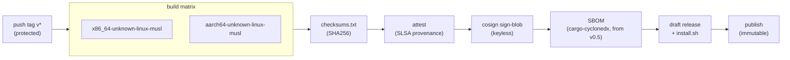

# Supply chain and release

A hardening tool that runs as root is a prime supply-chain target. Users who care about security are exactly the ones who won't `curl | bash`, so trust is a feature.

## Build

- **Toolchain:** Rust stable, pinned to an exact version for releases (1.98.1 as of 2026-10-11), edition 2024. Pinning matters because a different compiler version produces different bytes, which breaks reproducibility.
- **Targets:** `x86_64-unknown-linux-musl` and `aarch64-unknown-linux-musl`. musl targets link **statically** by default, so the binary runs on Ubuntu, Debian, Rocky and Alpine without caring about the host's glibc. Each target builds on a native runner (`ubuntu-24.04` and `ubuntu-24.04-arm`), so no cross linker is needed. Later, maybe `armv7` and `riscv64`.
- **Command:** `cargo build --release --locked --target <target>`. `--locked` makes the build fail if `Cargo.lock` would change, so CI builds exactly the dependency versions that were reviewed.
- **Release profile** (in the workspace `Cargo.toml`):

  ```toml
  [profile.release]
  lto = "fat"          # whole-program optimisation: smaller, faster binary
  codegen-units = 1    # slower build, better optimisation, more deterministic output
  panic = "abort"      # no unwinding tables; a panic ends the process
  strip = true         # drop symbols; smaller artifact
  ```

  Why `panic = "abort"` is safe here: the engine never relies on `Drop` running during a panic to clean up. A crash mid-transaction is handled the same way as a power cut, by the on-disk journal and the dead-man timer ([the architecture doc](architecture.md)).
- **Reproducible**, bit for bit. The steps that make it so:
  1. `--locked` plus the pinned toolchain: same inputs, same compiler.
  2. `SOURCE_DATE_EPOCH` set to the tag's commit timestamp, used for anything that would otherwise embed "now" (tarball mtimes, build metadata).
  3. `RUSTFLAGS="--remap-path-prefix=$HOME/.cargo=/cargo --remap-path-prefix=$PWD=/build"`, so absolute paths from the build machine don't leak into panic messages and debug info.
  4. Deterministic archives: `tar --sort=name --mtime=@$SOURCE_DATE_EPOCH --owner=0 --group=0 --numeric-owner`, then `gzip -n`.
  5. Document `make reproduce VERSION=v0.3.0`: it checks out the tag, builds both targets with the same toolchain in a container, and compares the SHA256 of each tarball with the published `checksums.txt`. Anyone can run it.

## Release pipeline

Hand-written in `.github/workflows/release.yml` and triggered by pushing a `v*` tag.



Only the last two steps need `contents: write`, and they run in the protected `release` environment, so a human approves before anything becomes public.

## What each release ships

| Artifact | Purpose |
|---|---|
| `vps-ready-<ver>-<target>.tar.gz` | the static binary (plus LICENSE-APACHE, LICENSE-MIT and README), one per target |
| `checksums.txt` | SHA256 of everything |
| `checksums.txt.sigstore.json` | **cosign keyless** signature bundle; signing the checksums covers all files |
| GitHub artifact attestation | **SLSA Build L3** provenance, built in a *reusable* workflow (the attestation starts at the first tag; moving the build into a reusable workflow for L3 comes later) |
| `vps-ready-<ver>.cdx.json` | from v0.5: SBOM in **CycloneDX** format, generated by `cargo-cyclonedx` from `Cargo.lock` |
| `.deb` / `.rpm` / `.apk` | from v0.5, via nFPM (language-agnostic, it just packages our binary), GPG-signed (deb/rpm) and RSA-signed (apk) |
| `install.sh` | generated **per release** with the hashes embedded |

**Release hardening:**
- Turn on GitHub **Immutable Releases** (assets and tags can't change after publishing). The workflow creates a draft, uploads everything, then publishes.
- Pin all actions by SHA.
- Default to `permissions: {}`, granting `id-token`/`attestations`/`contents: write` only to the jobs that need them.
- Use a protected `release` environment with a required reviewer, plus tag protection and harden-runner.

## Install paths (most → least trusted)

1. **Package repo:** apt `signed-by=` / dnf `gpgcheck=1` / apk keys. Updates come through the system package manager. (Host on GitHub Pages or Cloudsmith; this can come later, at v0.5+.)
2. **Manual verification:**
   ```sh
   cosign verify-blob --bundle checksums.txt.sigstore.json \
     --certificate-identity-regexp '^https://github.com/bhimrazy/vps-ready/\.github/workflows/release\.yml@refs/tags/v' \
     --certificate-oidc-issuer https://token.actions.githubusercontent.com checksums.txt
   sha256sum -c --ignore-missing checksums.txt
   # or: gh attestation verify vps-ready-*.tar.gz -R bhimrazy/vps-ready
   ```
3. **`install.sh`**, made "less bad":
   - POSIX sh, under 150 lines, wrapped in `main(){…}; main "$@"` so a truncated download can't half-run.
   - Attached to the immutable release, with the artifact hashes embedded.
   - Verifies SHA256, and cosign/gh too if they're installed. It says clearly when it couldn't.
   - Has `--dry-run`.
   - README order: `curl -fsSLO …/v0.3.0/install.sh && less install.sh && sh install.sh`. `curl | sh` is documented last.

### Rust users / CI

```sh
cargo install vps-ready --locked   # compiles from source
cargo binstall vps-ready           # downloads the GitHub release binary
```

- **`cargo install --locked`** builds on your machine from the source published to crates.io. `--locked` uses the `Cargo.lock` shipped in the crate; without it, cargo resolves the newest semver-compatible dependencies, which nobody has reviewed. Be honest about the trust model: this path is **only as trustworthy as crates.io and that lockfile**. No cosign signature or SLSA attestation covers it. (Publishing from CI with crates.io trusted publishing, so there is no long-lived token to steal, narrows the gap.)
- **`cargo binstall`** skips the compile and fetches the same `vps-ready-<ver>-<target>.tar.gz` from GitHub Releases, using `[package.metadata.binstall]` in `Cargo.toml` to find it. If you need the full chain, verify with the commands above.

## No self-update

A root tool that replaces itself is extra attack surface for a program that usually runs once per box. Provide `vps-ready version --check` (notify only) and let packages handle upgrades.

## Repo hygiene

- **Dependencies:** a short allowlist (see [the architecture doc](architecture.md)). Review every new crate with `cargo tree` (what does it pull in?) and `cargo tree -d` (duplicate versions). CI runs:
  - `cargo deny check`: advisories, licenses, banned crates and allowed sources in one tool, configured in `deny.toml`;
  - `cargo audit` against the RustSec advisory database;
  - `cargo clippy -- -D warnings` and `cargo fmt --check`;
  - OSV-Scanner and CodeQL (Rust support is GA since Oct 2025).
  - Later, optionally: `cargo vet` or `cargo crev` to record who audited which dependency version.
- **Dependabot:** `cargo` and `github-actions` ecosystems, grouped, weekly. Its `cooldown` option delays PRs for brand-new releases by a few days, which is when malicious versions usually get caught. Switch to Renovate only if we outgrow that.
- **OpenSSF Scorecard** action plus the Best Practices badge.
- **CODEOWNERS:** 2 reviewers for `crates/vps-ready/src/engine/`, `crates/vps-ready/src/modules/ssh/`, `crates/vps-ready/src/modules/firewall/`, `.github/`, `Cargo.lock`, `deny.toml` and `scripts/install.sh.tmpl`. (While you're solo this is aspirational, but set it up early.)
- **Why not cargo-dist (for now):** with only two musl targets and one tarball format, a generated workflow of several hundred lines isn't justified.
  For a tool whose pitch is "trust the release", we want every release step short enough to audit by reading it.
  cargo-dist stays a valid option to revisit if installers or targets multiply.
- **License: MIT OR Apache-2.0** (the Rust-standard dual license). Apache-2.0 brings a patent grant, MIT keeps it usable by GPLv2 projects; both are friendly to hosting providers and panels that might bundle it. GPL-licensed competitors (hostveil, hardbox) are less embeddable. Use DCO sign-off, no CLA.
- **SECURITY.md:** GitHub private vulnerability reporting, supported versions, how to verify releases, and which channels are official (GitHub Releases, crates.io `vps-ready` and `sshd-config`, and later the package repos).
