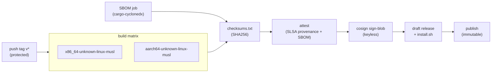

# Supply chain and release

A hardening tool that runs as root is a prime supply-chain target. Users who care about security are exactly the ones who won't `curl | bash`, so trust is a feature.

## Build

- **Toolchain:** Rust stable (no exact version is pinned today; pinning is planned for reproducible builds, because a different compiler version produces different bytes), edition 2024.
- **Targets:** `x86_64-unknown-linux-musl` and `aarch64-unknown-linux-musl`. musl targets link **statically** by default, so the binary runs on Ubuntu, Debian, Rocky and Alpine without caring about the host's glibc. Both targets build on an x86_64 `ubuntu-24.04` runner, linked with `rust-lld` and the musl CRT bundled with the Rust target (see `.cargo/config.toml`), so no cross toolchain is needed. Later, maybe `armv7` and `riscv64`.
- **Command:** `cargo build --release --locked --target <target>`. `--locked` makes the build fail if `Cargo.lock` would change, so CI builds exactly the dependency versions that were reviewed.
- **Release profile** (in the workspace `Cargo.toml`):

  ```toml
  [profile.release]
  lto = "fat"          # whole-program optimization: smaller, faster binary
  codegen-units = 1    # slower build, better optimization, more deterministic output
  panic = "abort"      # no unwinding tables; a panic ends the process
  strip = true         # drop symbols; smaller artifact
  ```

  Why `panic = "abort"` is safe here: the engine never relies on `Drop` running during a panic to clean up. A crash mid-transaction is handled the same way as a power cut, by the on-disk journal and the dead-man timer ([the architecture doc](architecture.md)).
- **Reproducible builds** (the target, not yet verified bit for bit). The steps:
  1. `--locked` plus the pinned toolchain: same inputs, same compiler.
  2. `SOURCE_DATE_EPOCH` set to the tag's commit timestamp, used for anything that would otherwise embed "now" (tarball mtimes, build metadata).
  3. Planned: `RUSTFLAGS="--remap-path-prefix=$HOME/.cargo=/cargo --remap-path-prefix=$PWD=/build"`, so absolute paths from the build machine don't leak into panic messages and debug info.
  4. Deterministic archives: `tar --sort=name --mtime=@$SOURCE_DATE_EPOCH --owner=0 --group=0 --numeric-owner`, then `gzip -n`.
  5. Planned: `make reproduce VERSION=v0.3.0`: it checks out the tag, builds both targets with the same toolchain in a container, and compares the SHA256 of each tarball with the published `checksums.txt`. Anyone can run it.

## Release pipeline

Hand-written in `.github/workflows/release.yml` and triggered by pushing a `v*` tag.



Only the last two steps need `contents: write`, and they run in the `release` environment, which only `v*` tags can use. Only a repository admin can create a `v*` tag, so pushing the tag is the human approval: the release runs without a further click.

## What each release ships

| Artifact | Purpose |
|---|---|
| `vps-ready-<ver>-<target>.tar.gz` | the static binary (plus LICENSE-APACHE, LICENSE-MIT, NOTICE and README), one per target |
| `checksums.txt` | SHA256 of everything |
| `checksums.txt.sigstore.json` | **cosign keyless** signature bundle; signing the checksums covers all files |
| GitHub artifact attestation | GitHub build-provenance attestation (SLSA Build L2 today; L3 needs the build in a reusable workflow, planned) |
| `vps-ready-<ver>.cdx.json` | from v0.5: SBOM in **CycloneDX** 1.5 JSON, generated by `cargo-cyclonedx` (pinned) from `Cargo.lock`, and attested with `actions/attest` (subjects: the tarballs and `.deb` files) |
| `vps-ready_<ver>_amd64.deb`, `_arm64.deb` | from v0.5, built with nFPM (pinned, checked against its release `checksums.txt`) from the musl binaries: `/usr/bin/vps-ready`, the `vpsready` link, no maintainer scripts. Not signed on their own: `checksums.txt` and the attestation cover them. `.rpm`, `.apk` and an apt repository wait until needed |
| `install.sh` | generated **per release** with the hashes embedded |

**Release hardening:**
- Turn on GitHub **Immutable Releases** (assets and tags can't change after publishing). The workflow creates a draft, uploads everything, then publishes.
- Pin all actions by SHA.
- Default to `permissions: {}`, granting `id-token`/`attestations`/`contents: write` only to the jobs that need them.
- Use `release` and `crates-io` environments limited to `v*` tags, plus tag rulesets: `v*` tags cannot be updated or deleted, and only repository admins can create them.

## Install paths (most → least trusted)

1. **Package repo:** apt `signed-by=` / dnf `gpgcheck=1` / apk keys. Updates come through the system package manager. (Host on GitHub Pages or Cloudsmith; this can come later, at v0.5+.)
2. **Manual verification:**
   ```sh
   cosign verify-blob --bundle checksums.txt.sigstore.json \
     --certificate-identity-regexp '^https://github.com/bhimrazy/vps-ready/\.github/workflows/release\.yml@refs/tags/v' \
     --certificate-oidc-issuer https://token.actions.githubusercontent.com checksums.txt
   sha256sum -c --ignore-missing checksums.txt
   # or: gh attestation verify vps-ready-*.tar.gz -R bhimrazy/vps-ready
   ```
3. **`install.sh`**, made "less bad":
   - POSIX sh, about 150 lines, wrapped in `main(){…}; main "$@"` so a truncated download can't half-run.
   - Attached to the immutable release, with the artifact hashes embedded.
   - Verifies SHA256, and cosign/gh too if they're installed. It says clearly when it couldn't.
   - Has `--dry-run`.
   - The README shows download, read, run; `curl | sh` is not documented.

### Rust users / CI

```sh
cargo install vps-ready --locked   # compiles from source; add --version <version> for a pre-release
```

- **`cargo install --locked`** builds on your machine from the source published to crates.io. `--locked` uses the `Cargo.lock` shipped in the crate; without it, cargo resolves the newest semver-compatible dependencies, which nobody has reviewed. Be honest about the trust model: this path is **only as trustworthy as crates.io and that lockfile**. No cosign signature or SLSA attestation covers it. (Publishing from CI with crates.io trusted publishing, so there is no long-lived token to steal, narrows the gap.) For the full chain of trust, use the release tarball and verify it with the commands above.

### Publishing to crates.io

- The `crates` job in `release.yml` publishes `sshd-config`, then `vps-ready` (which depends on it), then `vpsready`, with `cargo publish --workspace --locked` in the `crates-io` environment, using crates.io trusted publishing (no stored token).
- Trusted publishing cannot create a crate, so each crate's first version (`0.1.0-alpha.1`) was published by hand from a clean `main` with a short-lived API token, without pushing a tag. Both crates are configured for trusted publishing (owner `bhimrazy`, repo `vps-ready`, workflow `release.yml`, environment `crates-io`) and have **trusted publishing only** turned on, so an API token can no longer publish them.
- Pre-releases are tags such as `v0.1.0-alpha.2`: they go through the same workflow, become GitHub pre-releases, and `cargo install` skips them unless asked for with `--version`.
- The version appears three times in the root `Cargo.toml`: `[workspace.package] version` and the `=` pins of `vps-ready` and `sshd-config` in `[workspace.dependencies]`. Bump all together.
- `sshd-config` is published from v0.3.0 (it had `publish = false` before, and `vps-ready` depends on it). Trusted publishing cannot create it, and `cargo publish --workspace` refuses to start when any of its versions already exists on crates.io, so publishing `sshd-config` 0.3.0 by hand would make the tag's `crates` job fail. Before pushing the `v0.3.0` tag, once:
  1. From a clean `main`, set the version to `0.3.0-alpha.1` locally (the `[workspace.package]` version and the `sshd-config` pin), run `cargo publish -p sshd-config --allow-dirty` with a short-lived API token, then discard the edit. This creates the crate; nothing depends on that pre-release.
  2. Configure trusted publishing for `sshd-config` as for the other two (owner `bhimrazy`, repo `vps-ready`, workflow `release.yml`, environment `crates-io`), turn on **trusted publishing only**, and revoke the token.
  3. Push the tag: the `crates` job then publishes `sshd-config` 0.3.0 before `vps-ready`.
- If `vps-ready` uploads but `vpsready` fails, re-running the job fails on the already-published `vps-ready`. To recover, turn off trusted publishing only for `vpsready` in its crates.io settings, run `cargo publish -p vpsready --locked` with a short-lived token, then turn the setting back on and revoke the token.

## No self-update

A root tool that replaces itself is extra attack surface for a program that usually runs once per box. Provide `vps-ready version --check` (notify only) and let packages handle upgrades.

## Repo hygiene

- **Dependencies:** a short allowlist (see [the architecture doc](architecture.md)). Review every new crate with `cargo tree` (what does it pull in?) and `cargo tree -d` (duplicate versions). CI runs:
  - `ci.yml`: `cargo fmt --check`, `cargo clippy -D warnings`, `cargo test`, `cargo doc`, an MSRV check, musl builds, and `cargo deny check` (advisories from the RustSec database, licenses, banned crates and allowed sources, configured in `deny.toml`);
  - `codeql.yml`: CodeQL analysis;
  - `scorecard.yml`: OpenSSF Scorecard.
  - Later, optionally: `cargo vet` or `cargo crev` to record who audited which dependency version.
- **Dependabot:** `cargo` and `github-actions` ecosystems, grouped, weekly. Its `cooldown` option delays PRs for brand-new releases by a few days, which is when malicious versions usually get caught. Switch to Renovate only if we outgrow that.
- **OpenSSF Scorecard** action plus the Best Practices badge.
- **CODEOWNERS:** one owner (`@bhimrazy`) for everything, with explicit entries for `crates/vps-ready/src/engine/`, `crates/vps-ready/src/modules/ssh/`, `crates/vps-ready/src/modules/firewall/`, `.github/` and `scripts/`. Two reviewers on these paths once there are two maintainers.
- **Why not cargo-dist (for now):** with only two musl targets and one tarball format, a generated workflow of several hundred lines isn't justified.
  For a tool whose pitch is "trust the release", we want every release step short enough to audit by reading it.
  cargo-dist stays a valid option to revisit if installers or targets multiply.
- **License: MIT OR Apache-2.0** (the Rust-standard dual license). Apache-2.0 brings a patent grant, MIT keeps it usable by GPLv2 projects; both are friendly to hosting providers and panels that might bundle it. GPL-licensed competitors (hostveil, hardbox) are less embeddable. Use DCO sign-off, no CLA.
- **SECURITY.md:** GitHub private vulnerability reporting, supported versions, how to verify releases, and which channels are official (GitHub Releases, crates.io `vps-ready`, its alias `vpsready` and the `sshd-config` library from v0.3.0; the package repos later).
