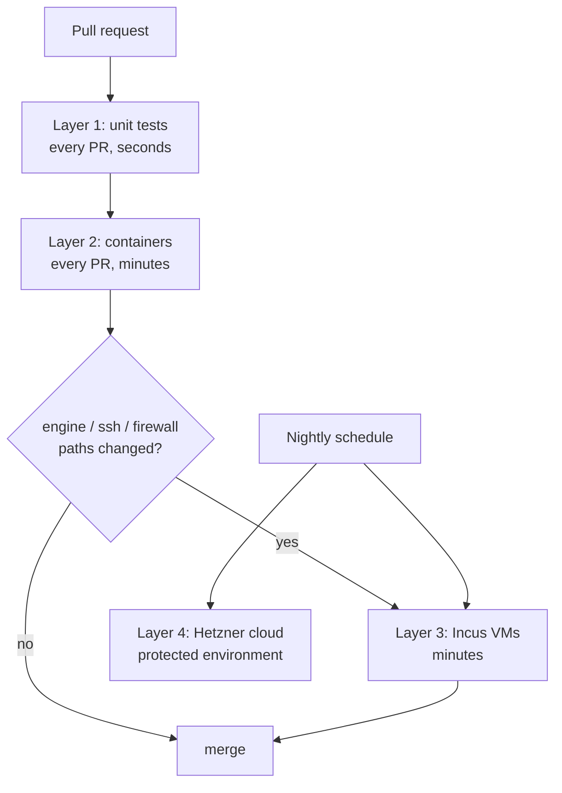

# Testing strategy

Today layers 1 (unit tests with fakes and captured host fixtures) and 2 (a smoke test of the real binary in systemd containers) exist; VMs come with M3 and cloud tests later.

The tool's whole promise is "safe on real servers", so testing is the product. There are four layers, each catching what the previous one can't.

## What runs when

The cheap layers run on every change; the slow, expensive ones run only where they can catch something the cheap ones can't.

## Layer 1: unit tests (every PR, seconds)

- All system access goes through two traits in the `sys` module:
  - `Runner`: the real one spawns processes; `FakeRunner` matches argv and returns stdout and an exit code.
  - `Fs`: the real one touches `/`; `FakeFs` is an in-memory map of paths to contents, so tests never touch the real filesystem.
- **Fixtures** captured from real images: `crates/vps-ready/testdata/os-release/<distro>/etc/os-release` and `crates/vps-ready/testdata/hosts/<distro>/` (ubuntu-24.04, debian-12, debian-13).
- **Snapshot tests** with `insta`: run each module against each distro fixture and snapshot the plan. When output changes on purpose, `cargo insta review` shows the diff and you accept or reject it. The snapshots are committed, so reviewers see exactly how a rendered config changed.
- **Property tests** with `proptest` (random inputs, shrunk to a minimal failing case):
  - plan → apply (to `FakeFs`) → plan must be **empty** (idempotency);
  - apply → rollback must restore the **exact** original tree (rollback fidelity).
- **Fuzzing** with `cargo-fuzz` for parsers: `sshd -T` output, os-release, nft output. Parsers read text the tool doesn't control, so they must never panic.
- **CLI tests** with `assert_cmd` + `predicates`: run the built binary, assert exit codes and output (e.g. `audit` exits non-zero on a failed control).

## Layer 2: containers (every PR, minutes)

**Today:** the `containers` CI job runs `test/container-audit.sh` on Ubuntu 22.04, Ubuntu 24.04, Debian 12 and Debian 13 (x86_64).

- The script boots the systemd test image (`--privileged --cgroupns=private`, 512 MB, 1 CPU), copies in the static musl binary built by `build-musl`, logs in over SSH once (which starts sshd on Ubuntu 24.04, where `ssh.socket` starts it on demand), and runs `detect` and `audit` as root, in human and `--json` form.
- It asserts that `detect` exits 0 and `audit` exits 0 or 1, never 2; that every `SSH-*` finding is pass or fail (so `sshd -T` worked); that every `KRN-*` and `NET-*` finding is skipped, since kernel settings belong to the host; and that a container is detected. It does not assert a total control count, so adding controls does not break it.
- `audit` is read-only. The apply and rollback cycle of `updates.auto` (apply, empty plan, `UPD-001` passes, rollback restores the managed files) is added to this job in #35, which lands separately. `kernel.sysctl` cannot run in a container, since containers share the host kernel's settings; it is covered by unit, property and rollback tests on a simulated `/proc/sys` (layer 1) and waits for layer 3 on a real VM.

**Planned:**

- A Rust test harness starting containers with `testcontainers-rs` or the plain `docker`/`podman` CLI, with a wider matrix: Ubuntu 26, Rocky 9/10, Fedora, Alpine (OpenRC instead of systemd), and `ubuntu-24.04-arm` runners for arm64.
- **Covers:** packages, services, users, fail2ban/CrowdSec, Docker install, unattended-upgrades, templates.
- **The full cycle:** apply → re-apply (no-op) → rollback → `diff -r /etc` against the snapshot.
- nftables works inside the container's own network namespace, which is good enough to check rule syntax and that apply/restore work.

## Layer 3: real VMs (PRs touching ssh/firewall/engine, plus nightly)

Containers can't test sshd socket activation, the host firewall, kernel sysctls, reboots, or the **dead-man switch**.

- **Incus VMs on GitHub-hosted Linux runners.** KVM works there after adding a udev rule.
- Scenarios, run from the runner:
  1. Apply the profile → SSH as the new user → assert success; assert root and password login are refused.
  2. Apply and **don't confirm** → assert the old config is back within timeout + 10 s.
  3. Reboot during the confirm window → assert it reverted.
  4. Change the port on Ubuntu 24.04 (`ssh.socket`) → assert `ss -ltn` shows the new port.
- **Locally on your Mac:** Lima, OrbStack or Multipass VMs (a `make vm` target is planned).

## Layer 4: real cloud (nightly, a few €/month)

- `hcloud` creates ephemeral Hetzner servers per distro and arch (CAX = arm64) using the exported cloud-init profile.
- This catches what only real provider images do: cloud-init sshd drop-ins, provider agents, IPv6 via router advertisements, provider firewalls.
- Run external `nmap` and SSH checks, then **always destroy** the servers (`trap`). The API token lives in a protected environment and never runs on fork PRs.
- Optionally add DigitalOcean/Vultr later.

## Reversibility honesty

Measure and publish rollback fidelity (hostveil publishes 89%), and label irreversible actions in the plan. Package upgrades can't be undone; account locks are only partially reversible.
