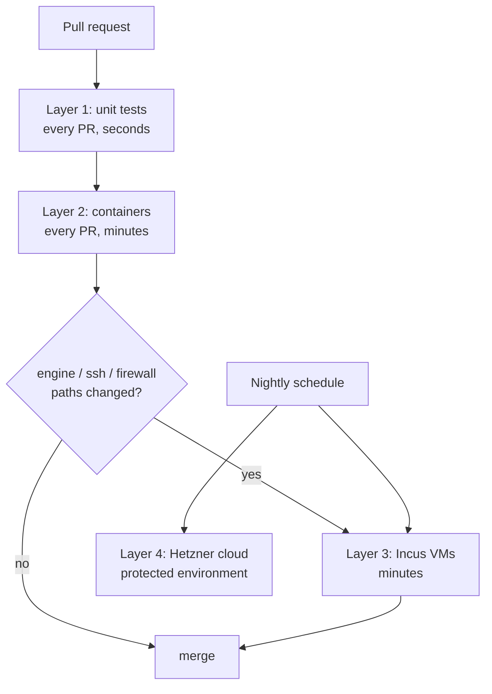

# Testing strategy

The tool's whole promise is "safe on real servers", so testing is the product. There are four layers, each catching what the previous one can't.

## What runs when

The cheap layers run on every change; the slow, expensive ones run only where they can catch something the cheap ones can't.

## Layer 1: unit tests (every PR, seconds)

- All system access goes through two traits in the `sys` module:
  - `Runner`: the real one spawns processes; `FakeRunner` matches argv and returns stdout and an exit code.
  - `Fs`: the real one touches `/`; `FakeFs` is rooted at a `tempfile::TempDir`, so tests can't escape into the real filesystem.
- **Fixtures** captured from real images: `testdata/ubuntu-24.04/etc/...`, `debian-13`, `rocky-9`, `alpine-3.2x`, etc.
- **Snapshot tests** with `insta`: run each module against each distro fixture and snapshot the plan. When output changes on purpose, `cargo insta review` shows the diff and you accept or reject it. The snapshots are committed, so reviewers see exactly how a rendered config changed.
- **Property tests** with `proptest` (random inputs, shrunk to a minimal failing case):
  - plan → apply (to `FakeFs`) → plan must be **empty** (idempotency);
  - apply → rollback must restore the **exact** original tree (rollback fidelity).
- **Fuzzing** with `cargo-fuzz` for parsers: `sshd -T` output, os-release, nft output. Parsers read text the tool doesn't control, so they must never panic.
- **CLI tests** with `assert_cmd` + `predicates`: run the built binary, assert exit codes and output (e.g. `audit` exits non-zero on a failed control).

## Layer 2: containers (every PR, minutes)

- A Rust test harness starts containers either with `testcontainers-rs` or by calling the plain `docker`/`podman` CLI, driven by a GitHub Actions matrix: Ubuntu 22/24/26, Debian 12/13, Rocky 9/10, Fedora, Alpine. Use `ubuntu-24.04-arm` runners for arm64.
- Images run **systemd as PID 1** (`--privileged --cgroupns=host`, or Podman `--systemd=always`); Alpine boots OpenRC.
- **Covers:** packages, services, users, fail2ban/CrowdSec, Docker install, unattended-upgrades, templates, audit exit codes.
- **The full cycle:** apply → re-apply (no-op) → rollback → `diff -r /etc` against the snapshot.
- nftables works inside the container's own network namespace, which is good enough to check rule syntax and that apply/restore work.

## Layer 3: real VMs (PRs touching ssh/firewall/engine, plus nightly)

Containers can't test sshd socket activation, the host firewall, kernel sysctls, reboots, or the **dead-man switch**.

- **Incus VMs on GitHub-hosted Linux runners.** KVM works there after adding a udev rule.
- Scenarios, run from the runner:
  1. Apply the profile → SSH as the new user → assert success; assert root and password login are refused.
  2. Apply and **don't confirm** → assert the old config is back within timeout + 10 s.
  3. Reboot during the confirm window → assert it reverted.
  4. Change the port on Ubuntu 24.04 (`ssh.socket`) → assert `ss -ltn` shows the new port.
- **Locally on your Mac:** Lima, OrbStack or Multipass VMs (`make vm D=debian13`).

## Layer 4: real cloud (nightly, a few €/month)

- `hcloud` creates ephemeral Hetzner servers per distro and arch (CAX = arm64) using the exported cloud-init profile.
- This catches what only real provider images do: cloud-init sshd drop-ins, provider agents, IPv6 via router advertisements, provider firewalls.
- Run external `nmap` and SSH checks, then **always destroy** the servers (`trap`). The API token lives in a protected environment and never runs on fork PRs.
- Optionally add DigitalOcean/Vultr later.

## Reversibility honesty

Measure and publish rollback fidelity (hostveil publishes 89%), and label irreversible actions in the plan. Package upgrades can't be undone; account locks are only partially reversible.
