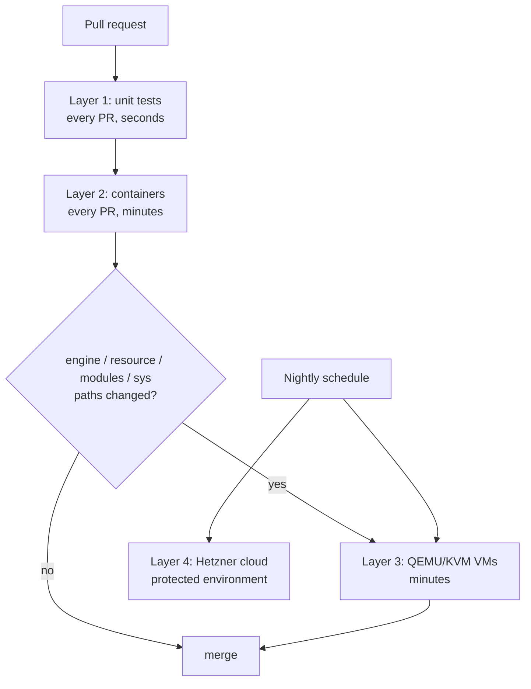

# Testing strategy

Today layers 1 (unit tests with fakes and captured host fixtures), 2 (the real binary in systemd containers) and 3 (the real binary in KVM virtual machines) exist; cloud tests come later.

The tool's whole promise is "safe on real servers", so testing is the product. There are four layers, each catching what the previous one can't.

## What runs when

The cheap layers run on every change; the slow, expensive ones run only where they can catch something the cheap ones can't.

## Layer 1: unit tests (every PR, seconds)

- All system access goes through two traits in the `sys` module:
  - `Runner`: the real one spawns processes; `FakeRunner` matches argv and returns stdout and an exit code.
  - `Fs`: the real one touches `/`; `FakeFs` is an in-memory map of paths to contents, so tests never touch the real filesystem.
- **Fixtures** captured from real images: `crates/vps-ready/testdata/os-release/<distro>/etc/os-release` and `crates/vps-ready/testdata/hosts/<distro>/` (ubuntu-24.04, debian-12, debian-13).
- **Snapshot tests** with `insta`: run each module against each distro fixture and snapshot the plan. When output changes on purpose, `cargo insta review` shows the diff and you accept or reject it. The snapshots are committed, so reviewers see exactly how a rendered config changed.
- **Property tests** with `proptest` (random inputs, shrunk to a minimal failing case):
  - plan → apply (to `FakeFs`) → plan must be **empty** (idempotency);
  - apply → rollback must restore the **exact** original tree (rollback fidelity).
- **Parsers never panic** on text the tool doesn't control: property tests feed the `sshd-config` reader and the `sshd -T` parser arbitrary input today; `cargo-fuzz` targets for `sshd -T`, os-release and nft output are planned.
- **CLI tests** with `assert_cmd` + `predicates`: run the built binary, assert exit codes and output (e.g. `audit` exits non-zero on a failed control).

## Layer 2: containers (every PR, minutes)

**Today:** the `containers` CI job runs `test/container-audit.sh`, `test/container-apply.sh`, `test/container-bruteforce.sh` and `test/container-admin.sh` on Ubuntu 22.04, Ubuntu 24.04, Debian 12 and Debian 13 (x86_64).

- The script boots the systemd test image (`--privileged --cgroupns=private`, 512 MB, 1 CPU), copies in the static musl binary built by `build-musl`, logs in over SSH once (which starts sshd on Ubuntu 24.04, where `ssh.socket` starts it on demand), and runs `detect` and `audit` as root, in human and `--json` form.
- It asserts that `detect` exits 0 and `audit` exits 0 or 1, never 2; that every `SSH-*` finding is pass or fail (so `sshd -T` worked); that every `KRN-*` and `NET-*` finding is skipped, since kernel settings belong to the host; and that a container is detected. It does not assert a total control count, so adding controls does not break it.
- `test/container-apply.sh` runs the `updates.auto` cycle in a fresh container: `apply --yes` exits 0, `plan --json` shows no changes, `UPD-001` passes, `history` shows the transaction as applied, and `rollback --last` restores the managed files (`52vps-ready` is gone; `unattended-upgrades` stays installed by design). `apply` runs `apt-get`, so the container needs network access. The image removes Docker's `/etc/apt/apt.conf.d/docker-*` files, which would otherwise disable periodic updates, as a cloud image does not have them.
- `test/container-bruteforce.sh` runs the `ssh.bruteforce` cycle the same way, with 1 GB: after `apply --yes`, `plan --json` shows no changes, fail2ban's `sshd` jail runs on the systemd backend and counts failed logins from the journal, a `banip` lands in nftables' `inet f2b-table`, `SSH-008` passes and `detect` sees the jail; `rollback --last` removes the drop-in, and the packages stay installed. The image has `netbase`, as cloud images do: nft before 1.1 needs `/etc/services` to resolve the jail's `port = ssh`.
- `test/container-admin.sh` runs `user.admin` from root's keys, one of them restricted with `command=` as on cloud images. `apply` runs in the background and waits for a confirm: the admin has only the plain key and a valid 0440 `NOPASSWD` drop-in, the printed `ssh` line and the `pending-confirm` record name the admin, and `plan --json` shows no changes. A new SSH login as another sudo user is refused by `confirm` (not the admin); `sudo vps-ready confirm` from a new login as the admin succeeds and `apply` exits 0. `rollback --last` removes the account, its keys and the drop-in and keeps the home directory. A second apply with `--deadman 1m` is rolled back by the timer (`deadman-timeout`), `apply` exits 1 and the boot hook ends disabled. The binary is chowned to root first, as the dead-man switch requires.
- `kernel.sysctl` cannot run in a container, since containers share the host kernel's settings. It is covered by unit, property and rollback tests on a simulated `/proc/sys` (layer 1) and on real VMs (layer 3).

**Planned:**

- A Rust test harness starting containers with `testcontainers-rs` or the plain `docker`/`podman` CLI, with a wider matrix: Ubuntu 26, Rocky 9/10, Fedora, Alpine (OpenRC instead of systemd), and `ubuntu-24.04-arm` runners for arm64.
- **Covers:** packages, services, users, fail2ban/CrowdSec, Docker install, unattended-upgrades, templates.
- **The full cycle:** apply → re-apply (no-op) → rollback → `diff -r /etc` against the snapshot.
- nftables works inside the container's own network namespace, which is good enough to check rule syntax and that apply/restore work.

## Layer 3: real VMs (PRs touching the engine or modules, plus nightly)

Containers can't test kernel sysctls, reboots, sshd socket activation, the host firewall, or the **dead-man switch**.

**Today:** the `vm` workflow (`.github/workflows/vm.yml`) runs `test/vm-cycle.sh` on Ubuntu 22.04, Ubuntu 24.04, Debian 12 and Debian 13 (x86_64). It is not a required check.

- **When:** pushes to `main`, nightly, by hand (`workflow_dispatch`), and pull requests that touch `crates/vps-ready/src/{engine,resource,modules,sys}/**`, `test/vm-*` or the workflow. It is a separate workflow so `ci` stays fast.
- **How:** plain QEMU with KVM on `ubuntu-24.04` (a udev rule opens `/dev/kvm` to the runner user). Each job boots the distro's official cloud image, pinned by URL and checksum and cached with `actions/cache`, with 2 vCPUs, 2 GiB and a copy-on-write overlay. A cloud-init NoCloud seed adds a user with passwordless sudo and a throwaway SSH key made in the job; the script drives the VM over SSH forwarded to `127.0.0.1`.
- **`kernel.sysctl`, same boot:** weaken five keys with `sysctl -w` (cloud images already pass), `apply --yes`, every control the module fixes passes, `rollback --last` puts the weak values back and removes the drop-in.
- **`kernel.sysctl`, across a reboot:** weaken, `plan`, `apply --yes`, reboot, every control the module fixes passes and `plan` is empty, then `rollback --last` exits 0, removes the drop-in and leaves the kernel settings to the next boot; after a second reboot they are back to the image's defaults. On Ubuntu the boot sets `fs.protected_regular` to 2, neither the weak nor the applied value, which v0.2.0 refused to roll back.
- **`updates.auto`:** the container cycle, with real apt and systemd.

- **The dead-man switch**, with the test module `test.deadman` (only in a binary built with `--features vps-ready/testing`) and `--deadman 1m`; `apply` runs in the background, since it waits for a confirm:
  - **timeout:** apply and do not confirm → within the deadline + 10 s the file is gone, the reason is `deadman-timeout`, the boot hook is disabled, logins work and `apply` exited 1;
  - **edited:** edit the managed file during the window → it is still reverted, and the edit is in `files/1.during`;
  - **confirm:** over real SSH logins from inside the VM to its own sshd, `confirm` is refused from the applying session, from a session opened before apply and through a `ControlMaster` connection; `--extend` works from any session; a new login confirms, `apply` exits 0, and the hook and timers are off;
  - **reboot:** `systemd-analyze verify` of the boot hook finds no ordering cycle; apply, reboot during the window → rolled back with `deadman-reboot`, and the hook finished before sshd started.
- **`ssh.server`**, over real logins to the VM's own sshd:
  - the `minimal` profile (`user.admin`, `ssh.server`, `firewall.inbound` and the rest) with a new admin: during the window a new root login is refused and sshd offers no password method → confirm as the admin → `SSH-001` to `SSH-007` and `FW-001` pass, the admin logs in and root does not → `rollback --last` removes the drop-in, the table and the admin, and root logs in again;
  - `--module ssh.server`, not confirmed: a new root login is refused (the reload reached new logins, also through `ssh.socket` on Ubuntu 24.04); the drop-in is edited → at the deadline it is gone and the edit is in `files/1.during`;
  - a `Match User` block with `PermitRootLogin yes` read before the drop-in → verify (`sshd -T -C`) fails and apply rolls back.
- **Checked by hand, not in the script** (Lima, Debian 13 and Ubuntu 24.04): the firewall drops a port it does not allow (port 80 timed out from another network namespace while 22 connected), a DHCP lease renewal works under it, a reboot in the window loads the firewall, then runs the hook, then starts sshd, and `systemd-analyze verify` of `vps-ready-firewall.service` is clean.

Layer 1 covers the rest of the dead-man design on fakes: a crash at every journal line after `armed`, a full disk during the rollback, the timer firing mid-apply, the confirm rules and their refusals, and session detection on fake `/proc` trees copied from real hosts.

**Locally on your Mac:** there is no KVM, but `test/vm-cycle.sh` can drive a Lima VM you already have (see [test/README.md](../test/README.md)).

## Layer 4: real cloud (nightly, a few €/month)

- `hcloud` creates ephemeral Hetzner servers per distro and arch (CAX = arm64) using the exported cloud-init profile.
- This catches what only real provider images do: cloud-init sshd drop-ins, provider agents, IPv6 via router advertisements, provider firewalls.
- Run external `nmap` and SSH checks, then **always destroy** the servers (`trap`). The API token lives in a protected environment and never runs on fork PRs.
- Optionally add DigitalOcean/Vultr later.

## Reversibility honesty

Measure and publish rollback fidelity (hostveil publishes 89%), and label irreversible actions in the plan. Package upgrades can't be undone; account locks are only partially reversible.
